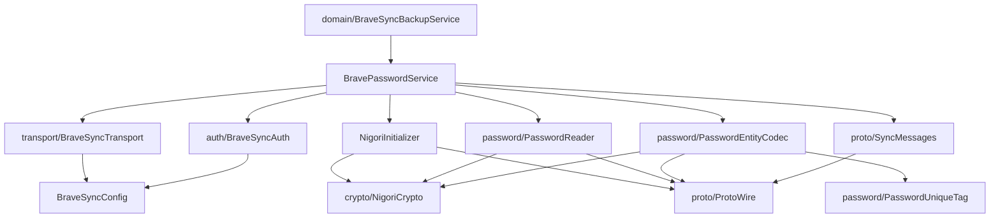
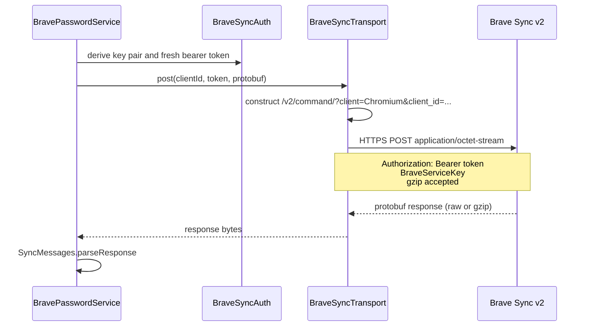
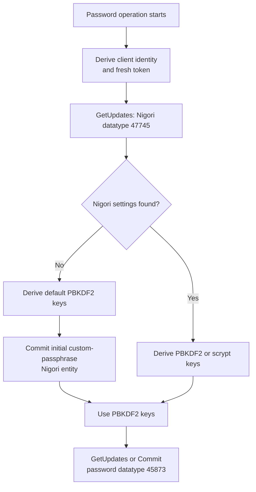
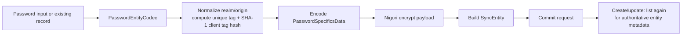
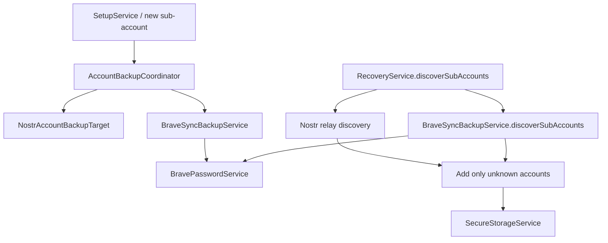

# Brave Sync Package Architecture

## Purpose and Scope

`app.zenten.vault.bravesync` is ZenTen Vault's **password-only Brave Sync adapter**. It stores and discovers Vault SSH-key backups as Brave password entries. It intentionally does not implement bookmarks, authenticator data, generic Sync datatypes, UI password management, background synchronization, or DNS fallback.

The package turns a Brave Sync code derived from the master SSH key into a short-lived in-memory Sync session, then uses Chromium/Brave-compatible wire messages and Nigori encryption to access the password datatype.

> This document describes the implementation currently in the repository. It is a package-level architecture reference; `brave-sync-password-implementation-plan.md` records the original implementation plan.

---

## Context

```mermaid
flowchart LR
    U[Unlocked master Account] -->|SSH key + passphrase| SC[Seedify]
    SC -->|25-word Brave Sync code| BS[BravePasswordService]

    subgraph Vault[ZenTen Vault]
      BS --> BC[Brave Sync protocol package]
      BBS[BraveSyncBackupService] --> BS
      ABC[AccountBackupCoordinator] --> BBS
      RS[RecoveryService] --> BBS
      DI[Hilt DomainModule] --> BBS
    end

    BC -->|Authenticated HTTPS protobuf| Server[Brave Sync v2\n sync-v2.brave.com]
    Server <-->|password entities| Brave[Brave browser(s)]
```

### Vault backup representation

The domain adapter deliberately limits Brave Sync records to a narrow, recognizable format:

| Backup kind | Password entry URL | Username | Password field | Notes |
| --- | --- | --- | --- | --- |
| Master account | `https://masterkey.zenten/` | `masterkey` | Canonical one-line Base64 OpenSSH private key | Empty |
| Sub-account | `https://<createdAt>.zenten/` | Decimal `createdAt` | Canonical one-line Base64 OpenSSH private key | Empty |

`BraveSyncBackupService` validates these fields when reading. Entries that do not match the Vault format, contain notes, or cannot be parsed as Ed25519 OpenSSH keys are skipped rather than imported.

---

## Package Structure and Responsibilities

```text
app/src/main/java/app/zenten/vault/bravesync/
├── BravePasswordService.kt       App-facing password CRUD façade
├── BraveSyncClient.kt            Connection/discovery lifecycle helper
├── BraveSyncConfig.kt            Endpoint, service key, type IDs, protocol constants
├── NigoriInitializer.kt          Initial Nigori entity for a new Sync chain
├── auth/
│   └── BraveSyncAuth.kt          Sync-code parsing, entropy, auth keys and bearer token
├── crypto/
│   └── NigoriCrypto.kt           Nigori KDFs, AES-CBC, HMAC and key naming
├── password/
│   ├── PasswordReader.kt         Password entity decryption and mapping
│   ├── PasswordEntityCodec.kt    Password create/update/delete entity construction
│   └── PasswordUniqueTag.kt      Chromium unique tag and client-tag hash
├── proto/
│   ├── ProtoWire.kt              Minimal protobuf wire encoder/decoder
│   └── SyncMessages.kt           Reduced Sync request, response and entity model
└── transport/
    └── BraveSyncTransport.kt     OkHttp POST, headers, gzip and HTTP errors
```

The package is internally layered. Dependencies flow inward toward protocol and crypto primitives; the domain layer depends only on `BravePasswordService`.



### Public and internal boundary

- **Domain-facing API:** `BravePasswordService` exposes `list`, `create`, `update`, and `delete`, plus its small `Password`, `Note`, and `ListResult` models.
- **Domain adapter:** `BraveSyncBackupService` maps domain `Account` objects to constrained password records and implements `AccountBackupTarget`.
- **Protocol implementation:** `BraveSyncAuth`, `NigoriCrypto`, `SyncMessages`, `ProtoWire`, password codecs, and `BraveSyncTransport` are implementation details and are `internal` where practical.
- **Lifecycle helper:** `BraveSyncClient` provides a focused authenticated Nigori-discovery session abstraction. The current CRUD service owns equivalent session setup itself, so `BraveSyncClient` is not currently on the operational CRUD path.

---

## Authentication and Key Derivation

No Sync credential is stored. Each operation derives all required material from the supplied 24- or 25-word Brave Sync code.

```mermaid
flowchart LR
    Code[24/25-word Sync code] --> First24[Validate and retain\nfirst 24 BIP-39 words]
    First24 --> Entropy[32-byte mnemonic entropy]
    Entropy --> HKDF[HKDF-SHA-512\nBrave salt + sync-auth-key]
    HKDF --> Priv[32-byte Ed25519 private key]
    Priv --> Pub[Ed25519 public key]
    Pub --> ClientID[Lowercase hex client ID]
    Priv --> Sign[Sign current timestamp]
    Pub --> Token[Base64 bearer token\ntimestamp|signature|public key]
    Sign --> Token

    First24 --> NigoriKDF[PBKDF2-SHA1 or scrypt\nper remote Nigori settings]
    NigoriKDF --> Keys[16-byte AES key\n16-byte HMAC key]
```

`BraveSyncAuth` performs the first branch:

1. It accepts exactly 24 or 25 whitespace-separated words and uses only the first 24.
2. It validates the BIP-39 words and extracts the 32-byte entropy—not the usual BIP-39 seed.
3. It derives the authentication private key with the Brave-specific HKDF-SHA-512 salt and `sync-auth-key` info value.
4. It derives the Ed25519 public key, which becomes the Sync client ID, and signs the current millisecond timestamp for the bearer token.

`NigoriCrypto` performs the encryption branch after settings discovery:

- **PBKDF2 configuration:** PBKDF2-SHA1 with Brave's fixed salt and separate iteration counts for user, encryption, and MAC keys.
- **scrypt configuration:** derives 32 bytes with server-supplied salt and splits them into AES and MAC keys.
- **Encryption format:** `IV || AES-128-CBC ciphertext || HMAC-SHA256(ciphertext)`.
- **Key name:** a deterministic encrypted/HMACed `nigori-key` stream, represented as Base64.

The active service keeps derived values only in local operation/session objects. `BraveSyncAuth.connect` clears its entropy buffer after authentication derivation; other intermediate JVM byte arrays should be treated as sensitive and are not persisted.

---

## Remote Protocol Boundary

`BraveSyncTransport` is the only component that performs network I/O.



### Request and response handling

- Endpoint: `https://sync-v2.brave.com/v2/command/` by default.
- The query includes `client=Chromium` and the Base64-encoded Ed25519 public key as `client_id`.
- The request includes Brave service-key, bearer authorization, binary protobuf content type, cache-control headers, and gzip support.
- Non-2xx responses become `IOException`; gzip is detected from either the response header or gzip magic bytes.
- `SyncMessages` uses the minimal required subset of the Chromium Sync protocol: GetUpdates, Commit, Sync entities, Password specifics, Nigori specifics, encrypted data, and Commit response groups.
- Server-level Sync errors are rejected before operation-specific parsing. A non-success commit entry result is also rejected.

`ProtoWire` is a deliberately reduced manual protobuf implementation. Field-number compatibility is therefore a critical interoperability boundary and is covered by protocol-focused unit tests.

---

## Operation Flows

### Establishing usable Nigori keys



For a new chain, `NigoriInitializer` commits an encrypted Nigori keybag with a custom-passphrase PBKDF2 configuration and `encrypt_everything` enabled. For an initialized chain, the returned Nigori settings select PBKDF2 or scrypt key derivation.

### List

1. Resolve a session and Nigori keys.
2. Send a GetUpdates request for datatype `45873` (passwords).
3. Ignore deleted and non-password entities.
4. Base64-decode and Nigori-decrypt each `PasswordSpecifics.encrypted` payload.
5. Decode password fields and default notes into `BravePasswordService.Password`.
6. Continue after per-entity decoding failures and expose their count in `ListResult`.

### Create, update, and delete



- **Create** generates a UUID entity ID, version `0`, and a manually-added password payload. It writes both `encrypted` and `encrypted_notes_backup` for non-deleted records, then re-lists to obtain the server-authoritative entry.
- **Update** preserves the stored server entity ID, version, and identity fields; it re-encrypts the replacement password and optional note before committing.
- **Delete** commits a deleted tombstone with the existing ID/version and minimal encrypted password specifics.
- **Identity** uses Chromium-compatible path escaping, a `|`-joined password unique tag, and a SHA-1 client-tag hash prefixed with the password datatype protobuf tag.

---

## Domain Integration



- `DomainModule` provides `BraveSyncBackupService` as a singleton, includes it in `AccountBackupCoordinator`, and supplies it to `RecoveryService`.
- Backup work runs on `Dispatchers.IO` inside `BraveSyncBackupService`, isolating the currently synchronous transport and password service from caller/UI threads.
- Before creating an entry, the adapter lists the remote passwords. A retry does not duplicate an existing record with the same URL and username; a differing existing payload is reported as an error rather than overwritten.
- Recovery is additive. `RecoveryService` merges valid Brave discoveries with Nostr discoveries and never silently removes local accounts.
- `BackupSyncService` supplies a separate five-minute cooldown around recovery discovery.

---

## Error Handling and Security Boundaries

| Boundary | Behavior |
| --- | --- |
| Invalid Sync code | Word count and BIP-39 validation fail before networking. |
| HTTP/network failure | `BraveSyncTransport` throws an `IOException`; domain backup wraps work in `Result`. |
| Sync server error | `BravePasswordService` rejects non-zero protocol error codes. |
| Commit rejection | Any non-success commit entry response becomes an error. |
| Unreadable remote entry | `PasswordReader` skips it, increments `decryptionFailures`, and continues. |
| Invalid Vault-format remote password | `BraveSyncBackupService` skips it and reports its entity ID. |
| Existing conflicting Vault backup | Backup fails rather than overwriting the remote record. |

Secrets crossing this package include the Sync code, mnemonic entropy, authentication private key/token, Nigori keys, decrypted password payloads, and SSH private-key backups. They must not be logged, persisted by this package, or exposed outside the unlock/backup flow. The transport sends only encrypted password specifics; Brave Sync operates as a storage and synchronization service for those ciphertexts.

---

## Tests and Compatibility Constraints

Existing focused tests are located in `app/src/test/java/app/zenten/vault/bravesync/`:

- `BraveSyncCryptoParityTest` validates Brave auth and Nigori crypto parity behavior.
- `PasswordEntityCodecTest` validates password entity and identity serialization behavior.
- `ProtoWireTest` validates the reduced protobuf wire implementation.

Compatibility-sensitive values include the Brave endpoint/service key, datatype IDs (`45873` Passwords and `47745` Nigori), all protobuf field numbers, HKDF and Nigori KDF parameters, AES/HMAC framing, password unique-tag escaping, and commit entity structure. Any change to these paths requires deterministic test vectors and live interoperability verification with a dedicated Sync code.

---

## Current Design Notes

1. **Password-only is intentional.** Although the generic Sync envelope can carry other datatypes, this adapter reads and writes only Password and Nigori entities.
2. **Session setup is per operation.** `BravePasswordService` derives a fresh token and resolves Nigori state for each top-level operation. This avoids credential caching but produces additional Nigori discovery requests. `create` and `update` subsequently call `list` to refresh metadata, which creates another session.
3. **No incremental progress markers.** GetUpdates requests currently use an empty progress token, so reads are full datatype fetches rather than incremental synchronization.
4. **No background synchronization.** The package is used for explicit backup/recovery flows; the domain cooldown protects repeated discovery calls.
5. **No DNS fallback or custom timeout policy.** The transport relies on the platform/OkHttp defaults. Any fallback must remain contained within `BraveSyncTransport` to preserve the upper-layer boundary.
6. **Manual protobuf is a maintenance risk.** The reduced `ProtoWire` approach keeps the binary small and focused, but schema evolution must be audited carefully against Chromium/Brave protocol behavior.
