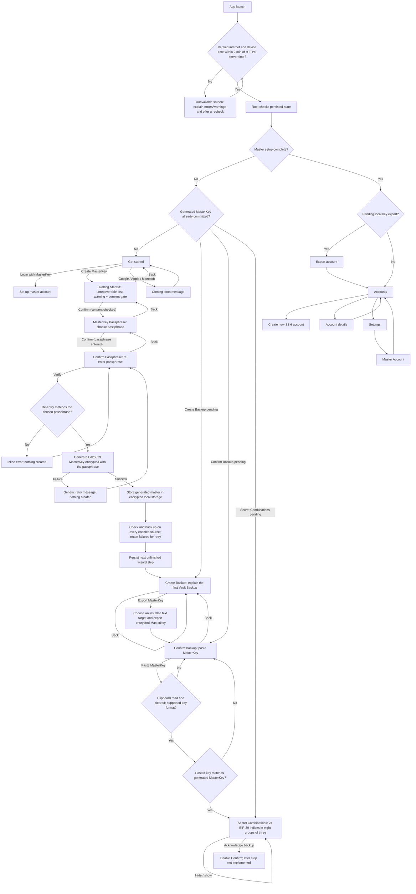
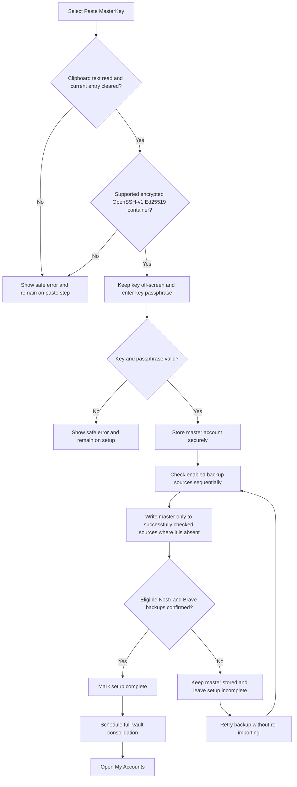
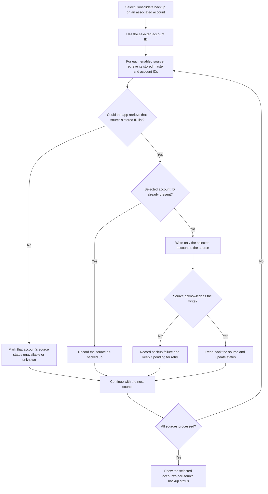
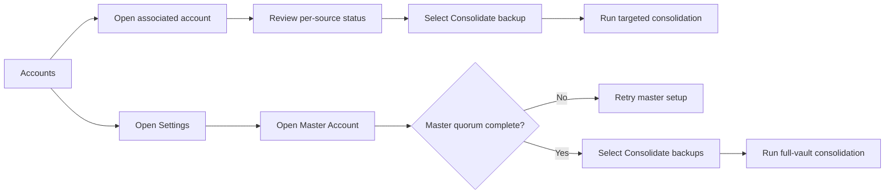

# App flowcharts

These diagrams are a discussion aid for the currently implemented Android proof of concept. They describe observed application behavior, not a production-readiness commitment. See [User journeys](user-journeys.md) for user goals and limitations, and [Backup and recovery](backup-and-recovery.md) for the user recovery responsibilities.

## App entry and navigation

The app resumes the mandatory export screen after a restart when an account has been created but its local export step has not yet been confirmed. It likewise resumes the generated-MasterKey wizard at **Create Backup** after the key has been committed, at **Confirm Backup** after Android accepted the export, or at **Secret Combinations** after the pasted key matched. Back navigation to key generation is blocked because generation is irreversible, while **Confirm Backup** can return to **Create Backup** to repeat the export.

## Master-account setup

The setup screen never renders the supplied key and does not show secret material in errors. Vault clears the current Android clipboard entry before opening the passphrase step, but operating-system or third-party clipboard history can remain outside its control. A failed source check is treated as unknown, not as permission to write another backup.

## Associated-account creation and local export

Launching the selected app is recorded, but Android cannot confirm that the receiving app retained the key. The in-app picker launches the chosen activity directly so the encrypted key remains a text export without exposing the Android Sharesheet's Copy action. Back navigation is blocked on the export screen until the user confirms the export. Confirmation removes the completed export screen from navigation history, so Back from **My Accounts** cannot reopen it. Profile publication runs as account-keyed unique WorkManager work, so relay latency or failure does not prevent navigation to **My Accounts**.

## Full-vault consolidation and automatic recovery

```mermaid
flowchart TD
    Trigger["Successful setup, Master Account action, or hourly work"] --> Phase1["Phase 1: build a remote inventory and restore missing local accounts"]
    Phase1 --> Index["For each enabled source, retrieve its stored master and account IDs"]
    Index --> IndexOK{"Could the app retrieve that source's stored ID list?"}
    IndexOK -->|No| Unknown["Mark the source unavailable or unknown and exclude it from this run's repair"]
    IndexOK -->|Yes| Restore{"Valid missing local account found on a trusted restore source?"}
    Restore -->|Yes| Recover["Decrypt, validate, and save the missing account locally"]
    Restore -->|No| NextSource["Continue collecting source inventories"]
    Recover --> NextSource
    Unknown --> NextSource
    NextSource --> AllIndexed{"All enabled sources checked?"}
    AllIndexed -->|No| Index
    AllIndexed -->|Yes| Phase2["Phase 2: repair missing remote backups"]
    Phase2 --> SelectSource["Choose a source whose inventory was retrieved successfully"]
    SelectSource --> Compare["Compare the complete local vault, including recovered accounts, with that source's inventory"]
    Compare --> MissingRemote{"Master or associated-account ID absent from this source?"}
    MissingRemote -->|Yes| Write["Write that missing backup to the source"]
    MissingRemote -->|No| NextAccount["Check the next local account"]
    Write --> Acknowledged{"Source acknowledges the write?"}
    Acknowledged -->|Yes| NextAccount
    Acknowledged -->|No| Pending["Record the failed backup as pending for retry"]
    Pending --> NextAccount
    NextAccount --> SourceComplete{"All local accounts checked for this source?"}
    SourceComplete -->|No| Compare
    SourceComplete -->|Yes| ReadBack["Read back the source and update per-source status"]
    ReadBack --> MoreSources{"Another successfully checked source?"}
    MoreSources -->|Yes| SelectSource
    MoreSources -->|No| Result["Show backed up, missing, failed, or unknown status"]
```

Phase 1 completes for every source before phase 2 begins. This ensures accounts recovered from one source are included when the app repairs another source. Existing local accounts are never overwritten by remote records. Sources whose inventory cannot be retrieved are not written to because the app cannot safely determine whether a backup is absent.

**How the source check works:** Before reading or writing account data, the app asks each backup source for its list of stored identifiers: `masterkey` for the master account and a numeric creation ID for each associated account. A successful response is a reliable basis for deciding whether a backup is already present or needs writing. A failed response does not prove an account is absent, so the app does not write to that source during the current run.

## Targeted account consolidation

Targeted consolidation only checks, writes, and updates status for the selected associated account. It does not restore missing accounts and does not process unrelated associated accounts.

## Backup-status actions

Per-source statuses are `Backed up`, `Missing`, `Checking`, `Backing up`, `Backup failed`, or `Unavailable / unknown`. The status reflects the latest completed or active operation; it is not a guarantee that a remote service remains reachable.
