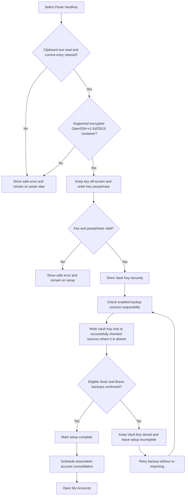
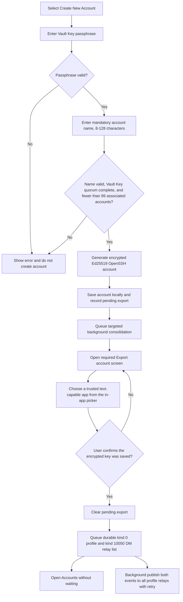
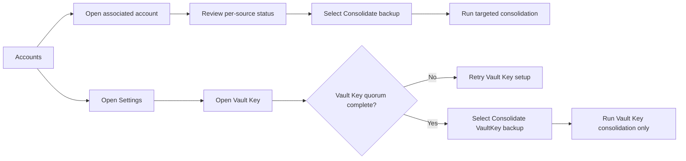
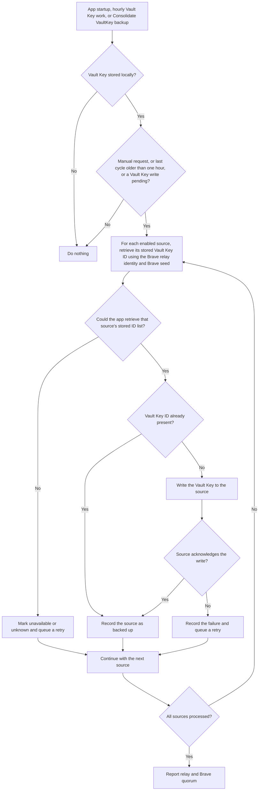

# App flowcharts

These diagrams are a discussion aid for the currently implemented Android proof of concept. They describe observed application behavior, not a production-readiness commitment. See [User journeys](user-journeys.md) for user goals and limitations, and [Backup and recovery](backup-and-recovery.md) for the user recovery responsibilities.

## App entry and navigation

```mermaid
flowchart TD
    Launch["App launch"] --> Prerequisites{"Verified internet and device time within 2 min of HTTPS server time?"}
    Prerequisites -->|No| Blocked["Unavailable screen: explain errors/warnings and offer a recheck"]
    Blocked --> Prerequisites
    Prerequisites -->|Yes| Root["Root checks persisted state"]
    Root --> Setup{"Vault Key setup complete?"}
    Setup -->|No| GeneratedProgress{"Generated VaultKey already committed?"}
    GeneratedProgress -->|No| Welcome["Get started"]
    GeneratedProgress -->|Create Backup pending| CreateBackupIntro
    GeneratedProgress -->|Confirm Backup pending| CreateConfirmBackup
    GeneratedProgress -->|Secret Combinations pending| CreateSecrets
    GeneratedProgress -->|Congratulations pending| Congratulations
    Welcome -->|"Login with VaultKey"| VaultKeySetup["Set up Vault Key"]
    Welcome -->|"Create VaultKey"| CreateIntro["Getting Started: unrecoverable-loss warning + consent gate"]
    CreateIntro -->|"Back"| Welcome
    CreateIntro -->|"Confirm (consent checked)"| CreatePassphrase["Create Passphrase: unmet rules disappear after 2-second success feedback"]
    CreatePassphrase -->|"Back"| CreateIntro
    CreatePassphrase -->|"Confirm (8+ chars; upper, lower, number, special)"| CreateConfirm["Re-enter Passphrase"]
    CreateConfirm -->|"Back"| CreatePassphrase
    CreateConfirm -->|"Verify"| CreateMatch{"Re-entry matches the chosen passphrase?"}
    CreateMatch -->|No| CreateMismatch["Inline error; nothing created"]
    CreateMismatch --> CreateConfirm
    CreateMatch -->|Yes| CreateProgressScreen["Creating VaultKey: no Back; warn not to close app"]
    CreateProgressScreen --> CreateGenerate["Show creation stage; generate encrypted Ed25519 VaultKey"]
    CreateGenerate -->|Failure| CreateGenerateFailed["Return to confirmation with generic retry message; nothing created"]
    CreateGenerateFailed --> CreateConfirm
    CreateGenerate -->|Success| CreateStore["Show secure-save stage; store generated Vault Key locally"]
    CreateStore --> CreateIdentity["Derive Nostr identity from the 24-word Brave sub-account mnemonic"]
    CreateIdentity --> CreateRemote["Use that identity for initial relay backup; use 24 words + daily 25th word for Brave Sync"]
    CreateRemote --> CreateProgress["Persist next unfinished wizard step"]
    CreateProgress --> CreateBackupIntro["Create Backup: explain the first Vault Backup"]
    CreateBackupIntro -->|"Back"| CreateBackupIntro
    CreateBackupIntro -->|"Export VaultKey"| CreateExport["Choose an installed text target and export encrypted VaultKey"]
    CreateExport --> CreateConfirmBackup["Confirm Backup: paste VaultKey"]
    CreateConfirmBackup -->|"Back"| CreateBackupIntro
    CreateConfirmBackup -->|"Paste VaultKey"| CreateClipboard{"Clipboard read and cleared; supported key format?"}
    CreateClipboard -->|No| CreateConfirmBackup
    CreateClipboard -->|Yes| CreateBackupMatch{"Pasted key matches generated VaultKey?"}
    CreateBackupMatch -->|No| CreateConfirmBackup
    CreateBackupMatch -->|Yes| CreateSecrets["Secret Combinations: 24 BIP-39 indices in eight groups of three"]
    CreateSecrets -->|"Hide / show"| CreateSecrets
    CreateSecrets -->|"Acknowledge backup + Continue"| VerifySecrets["Verify Secret Combinations: sequential segment entry"]
    VerifySecrets -->|"Wrong segment"| VerifyError["Red border; remain on current segment"]
    VerifyError --> VerifySecrets
    VerifySecrets -->|"Correct segment"| VerifySecrets
    VerifySecrets -->|"Back"| CreateSecrets
    VerifySecrets -->|"All 24 correct"| Congratulations["Completion: large outlined check for 3 seconds"]
    Congratulations -->|"Automatic"| MarkComplete["Mark generated VaultKey setup complete"]
    MarkComplete --> Accounts
    Welcome -->|"Google / Apple / Microsoft"| ComingSoon["Coming soon message"]
    ComingSoon --> Welcome
    Setup -->|Yes| PendingExport{"Pending local key export?"}
    PendingExport -->|Yes| Export["Export account"]
    PendingExport -->|No| Accounts["Accounts"]
    Export --> Accounts
    Accounts --> Create["Create new SSH account"]
    Accounts --> Detail["Account details"]
    Accounts --> Settings["Settings"]
    Settings --> Vault Key["Vault Key"]
    Detail --> Accounts
    Vault Key --> Accounts
```

After passphrase verification, the dedicated **Creating VaultKey** screen blocks system Back and provides creation, secure-save, and per-source synchronization progress until it advances automatically. Vault Key backup and consolidation use the Nostr identity derived from the 24-word `brave` sub-account mnemonic for relay operations; Brave Sync uses those same 24 words plus its daily 25th word. General associated-account consolidation uses the Vault Key Nostr identity on relays and the Brave seed on Brave Sync. The two record classes remain separate, so account consolidation cannot create a duplicate Vault Key relay copy under the Vault Key identity. The app resumes the mandatory export screen after a restart when an account has been created but its local export step has not yet been confirmed. It likewise resumes the generated-VaultKey wizard at **Create Backup** after the key has been committed, at **Confirm Backup** after Android accepted the export, at **Save your Secret Combinations** after the pasted key matched, or at **Congratulations** after every combination was verified. Back navigation to key generation is blocked because generation is irreversible, while **Confirm Backup** can return to **Create Backup** to repeat the export. Back from combination verification returns to the saved-combinations screen while preserving entered verification inputs, so returning to verification resumes at the active segment. The completion screen blocks Back, displays only a centered outlined check, then automatically marks setup complete after three seconds and replaces the wizard with the account list.

## Vault Key-account setup



The setup screen never renders the supplied key and does not show secret material in errors. Vault clears the current Android clipboard entry before opening the passphrase step, but operating-system or third-party clipboard history can remain outside its control. A failed source check is treated as unknown, not as permission to write another backup.

## Associated-account creation and local export



Launching the selected app is recorded, but Android cannot confirm that the receiving app retained the key. The in-app picker launches the chosen activity directly so the encrypted key remains a text export without exposing the Android Sharesheet's Copy action. Back navigation is blocked on the export screen until the user confirms the export. Confirmation removes the completed export screen from navigation history, so Back from **My Accounts** cannot reopen it. Profile publication runs as account-keyed unique WorkManager work, so relay latency or failure does not prevent navigation to **My Accounts**.

## Associated-account consolidation and automatic recovery

```mermaid
flowchart TD
    Trigger["Successful setup, account action, app startup, or hourly account work"] --> Phase1["Phase 1: build a remote inventory and restore missing local accounts"]
    Phase1 --> Index["For each enabled source, retrieve stored associated-account IDs"]
    Index --> IndexOK{"Could the app retrieve that source's stored ID list?"}
    IndexOK -->|No| Unknown["Mark the source unavailable or unknown and exclude it from this run's repair"]
    IndexOK -->|Yes| Restore{"Valid missing local account found on a trusted restore source?"}
    Restore -->|Yes| Recover["Decrypt, validate, and save the missing account locally"]
    Restore -->|No| NextSource["Continue collecting source inventories"]
    Recover --> NextSource
    Unknown --> NextSource
    NextSource --> AllIndexed{"All enabled sources checked?"}
    AllIndexed -->|No| Index
    AllIndexed -->|Yes| Phase2["Phase 2: repair missing remote backups"]
    Phase2 --> SelectSource["Choose a source whose inventory was retrieved successfully"]
    SelectSource --> Compare["Compare the complete local vault, including recovered accounts, with that source's inventory"]
    Compare --> MissingRemote{"Associated-account ID absent from this source?"}
    MissingRemote -->|Yes| Write["Write that missing backup to the source"]
    MissingRemote -->|No| NextAccount["Check the next local account"]
    Write --> Acknowledged{"Source acknowledges the write?"}
    Acknowledged -->|Yes| NextAccount
    Acknowledged -->|No| Pending["Record the failed backup as pending for retry"]
    Pending --> NextAccount
    NextAccount --> SourceComplete{"All local accounts checked for this source?"}
    SourceComplete -->|No| Compare
    SourceComplete -->|Yes| ReadBack["Read back the source and update per-source status"]
    ReadBack --> MoreSources{"Another successfully checked source?"}
    MoreSources -->|Yes| SelectSource
    MoreSources -->|No| Result["Show backed up, missing, failed, or unknown status"]
```



Phase 1 completes for every source before phase 2 begins. This ensures accounts recovered from one source are included when the app repairs another source. Existing local accounts are never overwritten by remote records. Sources whose inventory cannot be retrieved are not written to because the app cannot safely determine whether a backup is absent. This general flow excludes Vault Key records; Vault Key consolidation is handled independently with the Brave relay identity.

**How the source check works:** Before reading or writing account data, the app asks each backup source for its list of stored identifiers: `vaultkey` for the Vault Key and a numeric creation ID for each associated account. A successful response is a reliable basis for deciding whether a backup is already present or needs writing. A failed response does not prove an account is absent, so the app does not write to that source during the current run.

## Targeted account consolidation


Targeted consolidation only checks, writes, and updates status for the selected associated account. It does not restore missing accounts and does not process unrelated associated accounts.

## Backup-status actions



## Vault Key consolidation



Vault Key consolidation never restores, writes, or changes status for associated accounts, and the Vault Key is never restored from a remote copy. It runs on its own hourly schedule so a failed Vault Key backup is retried without depending on account consolidation.

Per-source statuses are `Backed up`, `Missing`, `Checking`, `Backing up`, `Backup failed`, or `Unavailable / unknown`. The status reflects the latest completed or active operation; it is not a guarantee that a remote service remains reachable.
