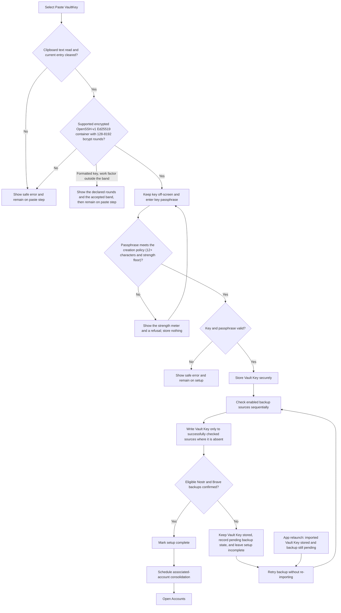
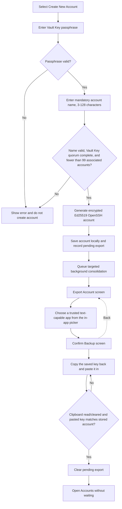
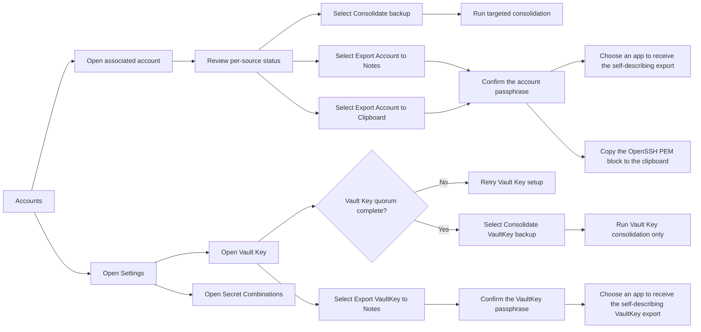
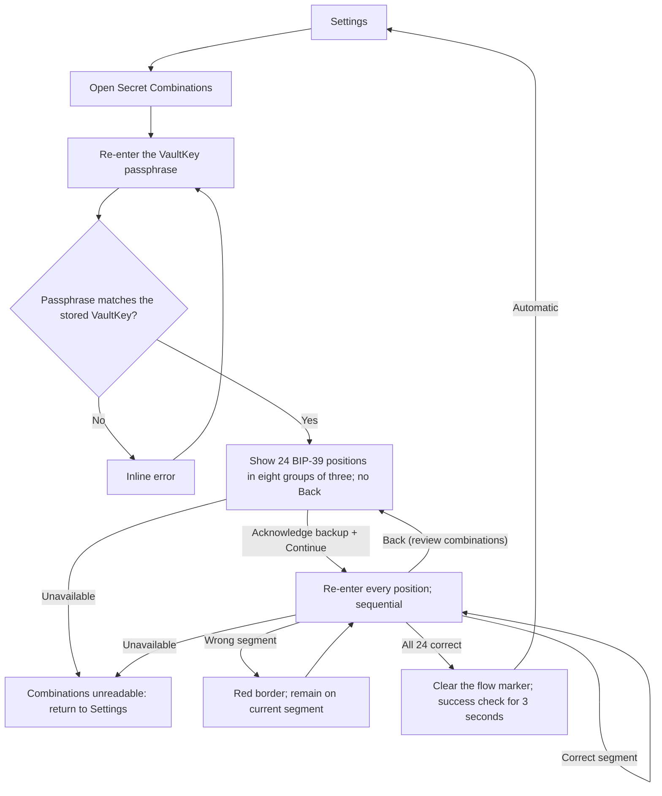
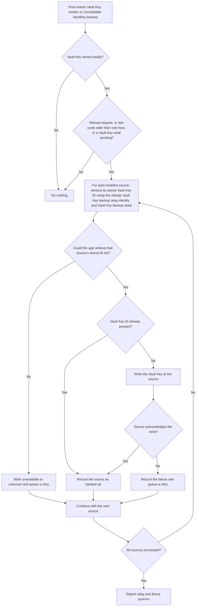

# App flowcharts

These diagrams describe the currently implemented Android app on its production track. They describe observed application behavior, not a production-readiness commitment or a statement that the app has been released. See [User journeys](user-journeys.md) for user goals and limitations, and [Backup and recovery](backup-and-recovery.md) for the user recovery responsibilities.

## App entry and navigation

```mermaid
flowchart TD
    Launch["App launch"] --> DeviceLock{"Secure device lock configured?"}
    DeviceLock -->|No| LockRequired["Block app: explain requirement and open Android security settings"]
    LockRequired --> DeviceLock
    DeviceLock -->|Yes| Authenticate["System prompt: strong biometric or device PIN / pattern / password"]
    Authenticate -->|Cancelled / failed| Locked["Locked screen: retry or leave app"]
    Locked --> Authenticate
    Authenticate -->|Success| VaultStored{"VaultKey stored?"}
    VaultStored -->|No| Prerequisites
    VaultStored -->|Yes| PassphraseGate["VaultKey passphrase screen: verify by decrypting stored key, keep in memory"]
    PassphraseGate -->|"Wrong / blank"| PassphraseGate
    PassphraseGate -->|Verified| Prerequisites{"Verified internet and device time within 2 min of HTTPS server time?"}
    Prerequisites -->|No| Blocked["Unavailable screen: explain errors/warnings and offer a recheck"]
    Blocked --> Prerequisites
    Prerequisites -->|Yes| Root["Root checks persisted state"]
    Root --> SecretReview{"Secret Combinations review unfinished?"}
    SecretReview -->|Yes| ReviewResume["Resume Secret Combinations review"]
    SecretReview -->|No| Setup{"Vault Key setup complete?"}
    Setup -->|No| GeneratedProgress{"Generated VaultKey already committed?"}
    GeneratedProgress -->|No| Welcome["Get started"]
    GeneratedProgress -->|Create Backup pending| CreateBackupIntro
    GeneratedProgress -->|Confirm Backup pending| CreateConfirmBackup
    GeneratedProgress -->|Secret Combinations pending| CreateSecrets
    Welcome -->|"Login with VaultKey"| VaultKeySetup["Set up Vault Key"]
    Welcome -->|"Recover VaultKey"| RecoverSecrets["Enter 8 saved Secret Combinations"]
    RecoverSecrets --> RecoverValid{"24 values in range with valid BIP-39 checksum?"}
    RecoverValid -->|No| RecoverSecrets
    RecoverValid -->|Yes| RecoverPassphrase["Enter VaultKey passphrase"]
    RecoverPassphrase --> RecoverStrength{"Passphrase meets the creation policy (12+ characters and strength floor)?"}
    RecoverStrength -->|No| RecoverWeak["Show the strength meter and a refusal; query no source"]
    RecoverWeak --> RecoverPassphrase
    RecoverStrength -->|Yes| RecoverSources["Query enabled Nostr relay and Brave Sync sources for the vaultkey record"]
    RecoverSources -->|"Missing / network / invalid passphrase / out-of-band KDF rounds in every copy"| RecoverError["Show safe error and allow retry"]
    RecoverError --> RecoverPassphrase
    RecoverSources -->|"Recovered, decrypted, and inside the KDF band"| RecoverStore["Store VaultKey, mark setup complete, schedule consolidation"]
    RecoverStore --> RecoverSession["Establish in-memory passphrase session"]
    RecoverSession --> Accounts
    Welcome -->|"Create VaultKey"| CreateIntro["Getting Started: unrecoverable-loss warning + consent gate"]
    CreateIntro -->|"Back"| Welcome
    CreateIntro -->|"Confirm (consent checked)"| CreatePassphrase["Create Passphrase: met length requirement disappears after 2-second success feedback"]
    CreatePassphrase -->|"Back"| CreateIntro
    CreatePassphrase -->|"Confirm (minimum 12 characters; strength meter at or above the policy floor)"| CreateConfirm["Re-enter Passphrase"]
    CreateConfirm -->|"Back"| CreatePassphrase
    CreateConfirm -->|"Verify"| CreateMatch{"Re-entry matches the chosen passphrase?"}
    CreateMatch -->|No| CreateMismatch["Inline error; nothing created"]
    CreateMismatch --> CreateConfirm
    CreateMatch -->|Yes| CreateProgressScreen["Creating VaultKey: no Back; warn not to close app"]
    CreateProgressScreen --> CreateGenerate["Show creation stage; generate encrypted Ed25519 VaultKey"]
    CreateGenerate -->|Failure| CreateGenerateFailed["Return to confirmation with generic retry message; nothing created"]
    CreateGenerateFailed --> CreateConfirm
    CreateGenerate -->|Success| CreateStore["Show secure-save stage; store generated Vault Key locally"]
    CreateStore --> CreateIdentity["Derive Nostr identity from the 24-word vkbckp (Vault Key BacKup) associated-account mnemonic"]
    CreateIdentity --> CreateRemote["Use that identity for initial relay backup; use 24 words + daily 25th word for Brave Sync"]
    CreateRemote --> CreateProgress["Persist next unfinished wizard step"]
    CreateProgress --> CreateBackupIntro["Create Backup: explain the first Vault Backup"]
    CreateBackupIntro -->|"Back"| CreateBackupIntro
    CreateBackupIntro -->|"Export VaultKey"| CreateExport["Choose an installed text target and export encrypted VaultKey"]
    CreateExport --> CreateConfirmBackup["Confirm Backup: paste VaultKey"]
    CreateConfirmBackup -->|"Back"| CreateBackupIntro
    CreateConfirmBackup -->|"Paste VaultKey"| CreateClipboard{"Clipboard read and cleared; supported key format?"}
    CreateClipboard -->|No| CreateConfirmBackup
    CreateClipboard -->|Yes| CreateBackupMatch{"Pasted key matches generated VaultKey?"}
    CreateBackupMatch -->|No| CreatePasteFail{"Failed paste number?"}
    CreatePasteFail -->|"1st / 2nd / 3rd"| CreatePasteBlocked["Safe error; block wizard 1 / 2 / 3 minutes behind a non-dismissible countdown"]
    CreatePasteBlocked --> CreateConfirmBackup
    CreatePasteFail -->|"4th"| CreateBackupIntro
    CreateBackupMatch -->|Yes| CreateSecrets["Secret Combinations: 24 BIP-39 indices in eight groups of three"]
    CreateSecrets -->|"Hide / show"| CreateSecrets
    CreateSecrets -->|"Acknowledge backup + Continue"| VerifySecrets["Verify Secret Combinations: sequential segment entry"]
    VerifySecrets -->|"Wrong segment"| VerifyError["Error-colored semi-bold text and inline message; remain on current segment"]
    VerifyError --> VerifySecrets
    VerifySecrets -->|"Correct segment"| VerifySecrets
    VerifySecrets -->|"Back"| CreateSecrets
    VerifySecrets -->|"All 24 correct"| CreateQuorum{"VaultKey backup reached relay plus Brave quorum?"}
    CreateQuorum -->|No| CreateQuorumMissing["Stay on verification screen: explain unconfirmed remote backup, offer Retry VaultKey backup"]
    CreateQuorumMissing -->|"Retry succeeds"| MarkComplete
    CreateQuorumMissing -->|"Retry fails"| CreateQuorumMissing
    CreateQuorum -->|Yes| MarkComplete["Mark generated VaultKey setup complete"]
    MarkComplete --> Accounts
    Welcome -->|"Google / Apple / Microsoft"| ComingSoon["Coming soon message"]
    ComingSoon --> Welcome
    Setup -->|Yes| PendingExport{"Pending local key export?"}
    PendingExport -->|Yes| Export["Export Account"]
    PendingExport -->|No| Accounts["Accounts"]
    Export --> ConfirmBackup["Confirm Backup"]
    ConfirmBackup --> Accounts
    ConfirmBackup -.->|Back| Export
    Accounts --> Create["Create new SSH account"]
    Accounts --> Detail["Account Details"]
    Accounts --> Settings["Settings"]
    Settings --> Vault Key["Vault Key"]
    Detail -->|"Back"| Accounts
    Detail -->|"Export Account to Notes"| DetailPassphrase{"Passphrase matches stored account?"}
    Detail -->|"Export Account to Clipboard"| DetailPassphrase
    DetailPassphrase -->|"No"| DetailPassphrase
    DetailPassphrase -->|"Yes, notes"| DetailExport["Choose an app to receive the self-describing export"]
    DetailPassphrase -->|"Yes, clipboard"| DetailClipboard["Copy the OpenSSH PEM block to the clipboard"]
    Vault Key -->|"Back"| Settings
```

The interactive app relocks on cold start or process restart, and requires authentication on the first foreground return after more than 30 seconds in the background, evaluated on return rather than by a timer. Returning sooner keeps the in-memory session unlocked; a continuously foregrounded app is not locked for inactivity. When a VaultKey is stored, passing device authentication is followed by a **VaultKey passphrase** screen; the passphrase is verified by decrypting the stored key, held only in memory, and dropped when the session relocks, so it is re-entered each session. Removing the device lock causes the next foreground check to show the mandatory setup warning. The whole activity blocks screenshots, screen recording, and sensitive Recents previews where Android supports it. This UI gate does not change trusted sibling-app access through the signature-protected KeyHive provider, but background consolidation now requires the unlocked in-memory passphrase and fails closed otherwise; a job that started while unlocked keeps its own passphrase copy, finishes after the foreground session locks, and zeroes the copy on completion.

After passphrase verification, the dedicated **Creating VaultKey** screen blocks system Back and provides creation, secure-save, and per-source synchronization progress until it advances automatically. Vault Key backup and consolidation use the Nostr identity derived from the 24-word `vkbckp` (Vault Key BacKup) associated-account mnemonic for relay operations; Brave Sync uses those same 24 words plus its daily 25th word. General associated-account consolidation uses the Vault Key Nostr identity on relays and the Vault Key backup seed on Brave Sync. The two record classes remain separate, so account consolidation cannot create a duplicate Vault Key relay copy under the Vault Key identity. The app resumes the mandatory export screen after a restart when an account has been created but its local export step has not yet been confirmed. It likewise resumes the generated-VaultKey wizard at **Create Backup** after the key has been committed, at **Confirm Backup** after Android accepted the export, or at **Save your Secret Combinations** after the pasted key matched. Back navigation to key generation is blocked because generation is irreversible, while **Confirm Backup** can return to **Create Backup** to repeat the export. A wrong **Confirm Backup** paste (unsupported or non-matching) is rate-limited: the first three failures block the wizard for one, two, and then three minutes behind a non-dismissible countdown, and the fourth returns to **Create Backup** and resets the counter; clipboard and storage errors are not counted. Back from combination verification returns to the saved-combinations screen while preserving entered verification inputs, so returning to verification resumes at the active segment. After all segments match, Vault checks the remote backup quorum recorded by the create-flow backup. If it was never reached, the verification screen stays open, explains that no relay plus Brave Sync copy of the VaultKey is confirmed, and offers **Retry VaultKey backup**; a retry that reaches quorum marks setup complete and replaces the wizard with the account list, while a retry that fails keeps the same blocked state. A reached quorum marks setup complete and replaces the wizard with the account list directly.

## Vault Key-account setup



The setup screen never renders the supplied key and does not show secret material in errors. Vault clears the current Android clipboard entry before opening the passphrase step, but operating-system or third-party clipboard history can remain outside its control. A failed source check is treated as unknown, not as permission to write another backup.

## Associated-account creation and local export



Launching the selected app is recorded, but Android cannot confirm that the receiving app retained the key; the paste-back check only proves the user kept a readable copy, not that it stays durable or private. The in-app picker launches the chosen activity directly so the encrypted key remains a text export without exposing the Android Sharesheet's Copy action. The exported text uses OpenSSH PEM markers around a single-line Base64 body, then adds the raw creation ID/timestamp, the account name (an empty line when the account has no name), and the account-detail card's full human-readable `Created on ...` date and time on separate lines. The associated account's `npub` is deliberately not exported. Back navigation is blocked on the export screen until the pasted key matches the stored account, which clears the current clipboard entry as part of the check. Confirmation removes the completed export screen from navigation history, so Back from **Accounts** cannot reopen it. The targeted background consolidation queued when the account was generated runs independently, so relay or Brave Sync latency or failure does not prevent navigation to **Accounts**. No kind 0 profile or kind 10050 DM relay list is published: the account name is carried publicly on the account's own backup record instead, as the plain `label` tag on its kind 37802 relay event and the `label: <name>` note on its Brave Sync record, and the creation screen does not disclose this (D4). Those remote copies can be replicated and cannot be recalled.

## Associated-account consolidation and automatic recovery


Phase 1 completes for every source before phase 2 begins. This ensures accounts recovered from one source are included when the app repairs another source. Existing local accounts are never overwritten by remote records. Sources whose inventory cannot be retrieved are not written to because the app cannot safely determine whether a backup is absent. This general flow excludes Vault Key records; Vault Key consolidation is handled independently with the `vkbckp` (Vault Key BacKup) Vault Key backup relay identity.

**How the source check works:** Before reading or writing account data, the app asks each backup source for its list of stored identifiers: `vaultkey` for the Vault Key and a numeric creation ID for each associated account. A successful response is a reliable basis for deciding whether a backup is already present or needs writing. A failed response does not prove an account is absent, so the app does not write to that source during the current run.

## Targeted account consolidation


Targeted consolidation only checks, writes, and updates status for the selected associated account. It does not restore missing accounts and does not process unrelated associated accounts.

## Backup-status actions



## Secret Combinations review



The review flow is entered from **Settings** and is gated by the VaultKey passphrase. Passing the gate records a non-secret step marker and makes the flow irreversible: the display step blocks system Back, Back from verification returns to the display to review the combinations, and the user must write down and re-enter all 24 positions before the flow ends. Returning to the display and continuing again preserves the values already verified. Verification input is strict and sequential, so a wrong segment is corrected in place rather than skipped. Killing the app after the gate reopens the precise unfinished step at next launch, and going Back from verification records the display step again so a restart resumes there. If the stored VaultKey cannot be decrypted at all there is nothing to transcribe, so only then does the flow offer a return to **Settings**. The transcribed values are held only in the flow's graph-scoped ViewModel and are never written to disk or navigation arguments.

## Vault Key consolidation



Vault Key consolidation never restores, writes, or changes status for associated accounts, and consolidation itself never restores a Vault Key from a remote copy — it only repairs a device that is already set up. Reading a remote Vault Key copy back into the app is the separate **Recover VaultKey** flow, which needs the 24 Secret Combinations and the passphrase. Consolidation runs on its own post-unlock schedule so a failed Vault Key backup is retried without depending on account consolidation. Both consolidation workers take the passphrase from the in-memory session and fail closed when it is locked; the passphrase is never stored or passed through WorkManager input.

Per-source statuses are `Backed up`, `Missing`, `Checking`, `Backing up`, `Backup failed`, or `Unavailable / unknown`. The status reflects the latest completed or active operation; it is not a guarantee that a remote service remains reachable.
