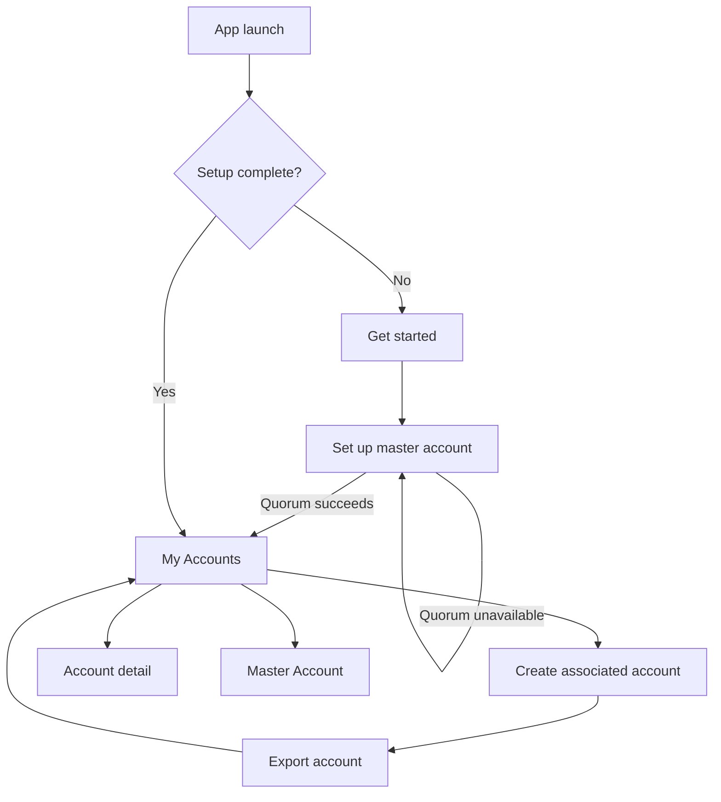

# Screens and states

This screen map reflects the current Android proof-of-concept navigation.

| Screen | Purpose | Main action | Important states |
| --- | --- | --- | --- |
| Get started | Introduce setup | Import SSH key | New installation |
| Set up master account | Import master private key/passphrase and establish quorum | Create or retry backup | Validating, quorum success, relay quorum missing, Brave quorum missing |
| My Accounts | List associated accounts and reach master details | Add account; open account; open Master Account | Loading, empty, recovering, populated |
| Create associated account | Generate a local-first account | Create account | Ready, creating, local success, scheduling error |
| Export account | Require an Android Sharesheet export before account use | Export to Notes | Chooser open |
| Account detail | Inspect account and per-source backup state | Show/copy private key | Missing, source checking/writing/present/missing/failed/unknown |
| Master Account | Inspect master and per-source backup state | Retry/consolidate as available | Quorum/status rows, checking, partial, failure |

The former global **Backup Status** screen and navigation destination have been removed. Backup information is attached to the account it describes.

## Navigation map

## Review notes

### Set up master account

- The screen accepts a passphrase-protected Ed25519 OpenSSH master key.
- On remote quorum failure, the imported master remains securely stored and retry does not require re-entry.
- Errors distinguish missing relay versus Brave coverage without including secret data.
- The screen remains protected from screenshots where supported.

### My Accounts

- Associated accounts only are listed as routine accounts; the screen has no top app bar, title, or explanatory header.
- Each account is a tappable credit-card-style card showing its grouped 16-digit ID, shortened SSH fingerprint, and localized creation date/time.
- Card color is stable per account ID and is decorative rather than a status signal.
- An extended Master Account floating action opens master source status and is stacked above the add-account floating action in the bottom-right corner.
- Automatic restoration occurs during consolidation; valid missing accounts appear after secure local persistence.

### Create associated account

- The account is stored locally before remote backup begins.
- Remote failures do not remove or disable the account.
- The UI should make clear that source backup may continue in the background.

### Local account backup

- Back navigation is blocked until the required backup route completes.
- The export screen sends the encrypted OpenSSH private key as plain text through the Android Sharesheet, allowing targets such as Keep, Messages, or email. The app considers this step complete when it opens the chooser.
- This is sensitive shared-media/share-target output, despite OpenSSH passphrase encryption. The screen is protected from screenshots where Android supports it.

### Account detail and Master Account

Each fixed source has its own row and live state: backed up, missing, checking, backing up, failed, or unknown. Internally, both a source-acknowledged write and a later read-confirmed copy display as **Backed up**; read-back is a reconciliation detail rather than a pending user action. Backed-up rows show the last successful backup time. Associated-account details provide **Consolidate backup** rather than a blind retry-write action: sources are checked first, only that account is reconciled, and existing canonical account IDs are not written again. The Master Account screen shows exactly one primary action: **Retry master setup** while quorum setup is incomplete, or **Consolidate backups** for the whole vault after setup completes. State must have textual/accessibility meaning rather than color alone. Timestamps may be shown, but secret payloads and authentication details must never appear.

### Sensitive private-key access

Private-key disclosure requires immediate confirmation, warning, secure-window protection, and safe copy feedback. Backup status does not weaken those controls.

## States requiring client approval

Before release, review final wording and behavior for quorum failure/retry, offline account creation, automatic restoration, partial and unknown source coverage, source authentication failure, account-not-found handling, and private-key warnings.
