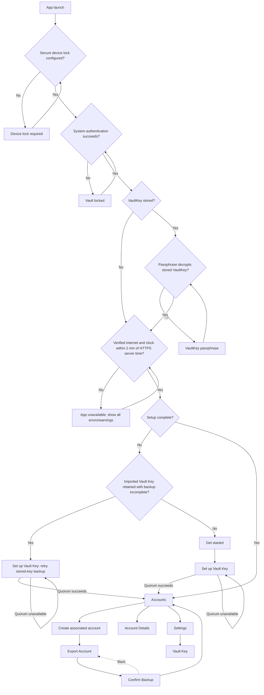

# Screens and states

This screen map reflects the current Android app navigation. The app always uses its dark visual theme; it does not follow the device's light or dark preference and offers no theme switcher.

## Visual palette

The fixed dark theme uses the design team's Material 3 palette, generated from the approved brand colors (seed `#D9D9D9`, error `#F36262`, success `#62F3B6`) and then overridden with the exact approved values where Material's generated tones differed. The visible result is the approved palette: primary `#D9D9D9`, background and base surface `#121212`, cards and raised surfaces `#232323`, accent and borders `#3A3A3A`, primary text `#FFFFFF` with secondary text `#B6B6B6`, error `#F36262`, and success `#62F3B6`. Success is exposed as an app-specific semantic color because Material has no equivalent role. Text and accessible state labels continue to identify status without relying only on color.

The palette also includes light, medium-contrast, and high-contrast variants. They are defined but not selectable today: the app still ships only the standard-contrast dark theme, and the extra variants exist so a future accessibility setting can enable them without a redesign. Those accessibility variants intentionally keep Material's generated colors rather than the brand overrides, so their contrast guarantees hold. The launcher icon is the app's own shield mark on a `#121212` plate, so it matches the app background instead of using a palette role, and **Get started** draws the same mark on that same background so the in-app logo and the icon are identical.

| Screen | Purpose | Main action | Important states |
| --- | --- | --- | --- |
| Vault locked | Require Android device authentication before any vault navigation | Unlock | Prompt active, cancelled, failed, or retry available |
| VaultKey passphrase | Require the unpersisted VaultKey passphrase after device authentication, before the vault opens | Unlock | Verifying, wrong/blank passphrase, no VaultKey stored (skipped for onboarding) |
| Device lock required | Block use until a secure device lock is configured | Open security settings; check again | No accepted device credential configured |
| App unavailable | Block vault navigation until safe remote-backup prerequisites are restored | Check again | No verified internet, device clock differs from HTTPS server time by over two minutes, or both |
| Get started | Introduce the vault and offer first-run entry paths | Login with VaultKey | New installation; unimplemented action tapped ("coming soon") |
| Set up Vault Key | Import Vault Key private key/passphrase and establish quorum | Create or retry backup | Validating, quorum success, relay quorum missing, Brave quorum missing |
| Accounts | List associated accounts and reach app settings | Create account; open account; open Settings | Loading, empty, recovering, populated |
| Settings | Provide vault-management entry points and SSH key-generation controls | Open Vault Key; open Secret Combinations; choose KDF rounds | Ready |
| Create associated account | Generate a local-first account | Create account | Ready, creating, local success, scheduling error |
| Export Account | Send the encrypted key to a trusted app before account use | Export to Notes | In-app app picker open, no compatible apps, launch rejected |
| Confirm backup | Prove the exported account key was kept before account use | Paste Account Key | Paste malformed/mismatched/unreadable/empty |
| Account Details | Inspect account identity and per-source backup state | Export Account to Notes; Export Account to Clipboard; consolidate backup | Missing, source checking/writing/present/missing/failed/unknown; passphrase prompt open, wrong/blank passphrase; export picker open, no compatible apps, launch rejected; clipboard copy succeeded/failed |
| Vault Key | Inspect Vault Key and per-source backup state | Export VaultKey to Notes; retry/consolidate as available | Quorum/status rows, checking, partial, failure; passphrase prompt open, wrong/blank passphrase; export picker open, no compatible apps, launch rejected |

The former global **Backup Status** screen and navigation destination have been removed. Backup information is attached to the account it describes.

## Vault lock

A cold start or process restart always requires Android's system authentication prompt. Strong biometrics and the device PIN, pattern, or password are accepted. Cancelling or failing leaves a stable locked screen with an **Unlock** action; navigation is never rendered behind it. Returning to the foreground after more than 30 seconds in the background requires authentication again and drops the foreground passphrase session. The boundary is measured with monotonic elapsed time and evaluated on return, not by a timer, so a continuously foregrounded app is not locked for inactivity.

When a VaultKey is stored, device authentication is followed by a **VaultKey passphrase** screen. The passphrase is verified by decrypting the stored VaultKey, kept only in memory for the session, and re-entered after each relock or process restart; it is never written to disk. The input is masked by default with a trailing eye icon that toggles between **Show passphrase** and **Hide passphrase**, and the reveal state is never persisted. A fresh install with no stored VaultKey skips the screen and gets the passphrase during onboarding.

If the device has no accepted secure lock, the app instead presents **Set up a device screen lock**, with actions to open Android security enrollment and check again. There is no skip path. Prompt errors that mean the device cannot satisfy the policy also route here, while cancellation and lockout remain on the locked screen. The whole activity prevents screenshots, screen recording, and sensitive Recents previews where Android supports it. This is an interactive lock screen only: it does not restrict the signature-protected KeyHive provider, but background consolidation now requires the unlocked in-memory passphrase.

## App unavailable

The app does not expose vault navigation until it has a system-validated internet connection and its clock is within two minutes of HTTPS server time. A captive portal or a merely connected local network is not sufficient. The app makes `HEAD` requests to Google and Cloudflare in order, uses their HTTP `Date` response header, and offsets the server value by half the request round-trip time. The first usable response is compared with the device clock. If neither source can provide time, the app does not claim that the clock is wrong and allows navigation once internet is validated. The blocking screen lists every proven unmet prerequisite, explains that incorrect time can invalidate backup authentication, and provides a **Check again** action. It rechecks on launch, resume, network changes, and manually.

## Navigation map

## Review notes

### Get started

- The screen shows the app icon (the vault shield mark on its `#121212` background, exactly as the launcher renders it; the asset is cropped to the shield, so it carries no transparent padding and the mark is sized to the shield's 0.8017 aspect ratio), a welcome title, and a short purpose description.
- **Create VaultKey** opens the Create VaultKey wizard, whose implemented screens collect consent and a passphrase, verify the passphrase, generate the VaultKey, export it as the first local Vault Backup, and verify the exported copy by pasting it back.
- **Login with VaultKey** is the only implemented action and opens **Set up Vault Key** to import an existing Ed25519 OpenSSH key. It uses a neutral raised surface rather than the primary action color to show its secondary visual priority.
- An "or continue with" separator precedes **Google**, **Apple**, and **Microsoft** buttons. Each has a right-aligned **Coming soon** label and is disabled because these providers are not implemented.
- Every unimplemented action shows a short "coming soon" snackbar naming the action. A new message replaces any visible one, so repeated taps do not queue up.
- All colors come from the app theme. Multi-color third-party brand marks are the deliberate exception: their colors live inside the vector assets because brand guidelines forbid recoloring, and the app's own shield mark lives in its asset for the same reason once it is no longer tinted. The monochrome Apple mark is tinted from the theme.
- The content scrolls vertically so short screens cannot clip the buttons.

### Create VaultKey wizard

- All wizard steps share one page frame: a header row with an icon-only back arrow on the left, a centered hero illustration with the centered title below it, step content, and a bottom-anchored action button. The back arrow uses the normal text color (never an accent/link color) and carries its meaning through an accessibility label instead of a visible "Back" word. Each step supplies its own illustration (pen-and-paper for **Getting Started**, a padlock for **Create Passphrase**, a padlock inside a repeat arrow for **Re-enter Passphrase**, a safe with a combination dial for **Create Backup**, and the confirmation artwork for **Confirm Backup**); all are scaled to fit the same square footprint so the title does not shift between steps, and each has a screen-reader description because the artwork conveys what the step is about. These illustrations are multi-tone line art whose colors live in the vector assets rather than being tinted from the theme, which is safe because the app always renders its dark scheme. Each page scrolls so a short screen cannot clip the button. Supporting copy is not part of the shared frame; each step supplies its own if it needs one.
- When the soft keyboard opens on a passphrase step, the page frame shrinks by the keyboard height rather than sliding beneath it, so the action button (**Confirm** or **Verify**) moves up and stays visible and tappable above the keyboard while the upper content remains scrollable.
- Step 1 (**Getting Started**) shows the unrecoverable-loss warning and the consent checkbox that gates **Confirm**.
- Step 2 (**Create Passphrase**) shows an unlabeled passphrase field obscured by default with an eye toggle. Below it are two stacked rows rather than a side-by-side grid, because they answer different questions — "is it long enough?" and "is it hard to guess?":
  - A **Minimum 12 characters** requirement with a state dot. It is evaluated on every keystroke and, once met, holds its success check and success color for two seconds before collapsing so the strength meter becomes the focus; it returns immediately if the passphrase drops back below the floor.
  - A five-segment strength meter, one segment per zxcvbn bucket. Segments below the policy floor fill red and segments at or above it fill green, with an animated hand-off; empty segments stay visible as a neutral track so the remaining range is legible. Its label row states the band in words — "Passphrase Strength: Strong" — and leaves the concrete crack-time estimate to the sheet, so the line reads as a verdict rather than a statistic. It appears once a measurement exists, that is after the passphrase clears the length floor and the estimator's short typing pause has elapsed. The label row is exposed to accessibility services as a single "Passphrase Strength: Strong" node instead of five decorative shapes.
  - An info button beside the bar opens a **Passphrase strength** bottom sheet explaining the rating. It repeats the band and bar, then shows the **Strength score** as a number directly beneath the bar. **Time to crack** lists both offline scenarios and what each would cost — **Slow hash (10,000 guesses per second)** and **Fast hash (10 billion guesses per second)**. The first is the real situation, since Vault's KDF is a slow one; the second shows what a weak hash would cost, so the value of the slow hash is visible rather than asserted. **What we noticed** lists the estimator's decomposition in passphrase order — every match, including the stretch it could not explain. Each entry leads with the matched text in quotes and zxcvbn's own pattern name (**Dictionary**, **Spatial**, **Repeat**, **Sequence**, **Regex**, **Date**, **Bruteforce**), and its second line explains it: what that pattern means in plain words, the match length, which ranked list matched and its rank where one applies, which keyboard and how many turns, how many repeats, whether a run ascends or descends, and what the match cost in guesses. Nothing is merged or reordered, so the entries account for the whole passphrase. The matched text is shown deliberately: a pattern and a span alone cannot tell `alice@` from any other six-character run, which is exactly the confusion this list exists to remove. This sheet is therefore the only place besides the input field that renders passphrase content, and it stays on screen only while the user holds it open. **How to improve it** lists every suggestion the estimator offers, and is omitted when there are none. Opening the sheet clears focus first so the keyboard cannot squeeze it. A **Close** button waits for the sheet's exit animation, so closing looks the same as swiping it away.

  **Confirm** appears only when both requirements are met, about a quarter-second after the last keystroke, and re-checks them before the passphrase is retained so an edit made in the instant before the tap cannot slip through. No character-class rules are shown, because none are enforced: a long passphrase with no digit or symbol is accepted, while a short one containing all four classes is not.
- Step 3 (**Re-enter Passphrase**) likewise shows only its title and an unlabeled passphrase field with the same eye toggle. **Verify** is enabled once text is entered. It compares this entry with the passphrase chosen in step 2:
  - If they differ, an inline red message asks the user to re-enter the chosen passphrase and nothing is created, so a typo in an unrecoverable secret cannot be baked into a key. The message clears as soon as the field is edited again.
  - If they match, the app generates a new Ed25519 OpenSSH VaultKey encrypted with that passphrase. While this runs the action is inert and reads **Creating VaultKey…**, because the passphrase-to-key derivation is deliberately slow. On success the wizard advances to step 4; on failure a generic retry message is shown that never echoes key or passphrase material.
- After a passphrase match, the non-dismissible **Creating VaultKey** screen shows a terminal-style transcript. Each line continuously churns as safe random glyphs while its real operation runs, then resolves when complete: encrypted VaultKey creation, Nostr key-pair derivation, Sync Code derivation, and each configured Nostr Relay or Sync Server backup attempt in order. Completed lines remain visible, while accessibility services receive a neutral progress status instead of the glyphs. After every attempt finishes, a circular checkmark and **VaultKey created successfully** remain visible for two seconds before the wizard advances. Disabling system animations skips visual churn.
- Step 4 (**Create Backup**) explains that the first Vault Backup is a digital backup the user must store safely themselves, for example in a preferred encrypted notes app, and repeats the unrecoverable-loss warning directly above the action. **Export VaultKey** opens the same direct installed-app target picker used for associated-account local backup, exports the encrypted OpenSSH key in the same self-describing text format (PEM markers around a single-line Base64 body, then the `npub`, raw creation ID/timestamp, the fixed `VaultKey` display name, and the account-detail-style full `Created on ...` date and time), records **Confirm Backup** as the durable resume point, and advances there after Android accepts the target intent.
- Step 5 (**Confirm Backup**) tells the user to upload the safely stored backup and offers **Paste VaultKey**. It reads and immediately clears the clipboard like the import flow, validates a supported encrypted Ed25519 OpenSSH key, and verifies that it exactly matches the generated VaultKey. Errors never display secret material. A wrong paste (unsupported or non-matching) is rate-limited: the first three failures block the wizard for one, two, and then three minutes behind a non-dismissible countdown that disables Back, and the fourth returns the user to **Create Backup** with the counter reset. The failed-attempt count and non-secret deadline survive a process restart; clipboard or storage errors are not counted. The user may also go back to **Create Backup** and export again, which clears the counter.
- Step 6 (**Save your Secret Combinations**) shows the 24 one-based English BIP-39 word-list indices of the Vault Key-derived Brave Sync mnemonic in eight numbered rows (1–8) of three. A compact warning tells the user to write down all eight combinations, store them offline, and that Vault cannot restore lost combinations; a separate prompt makes clear that the picker scrolls to reveal all eight. Only the three-row combinations picker scrolls: it sits near the screen’s visual center, snaps the active row to the center as an elevated card at full opacity, fades adjacent cards directionally toward the picker edges, and lets the first and last rows center without looping. The short acknowledgement and **Continue** action remain anchored at the bottom. The values can be hidden, screenshots are blocked, and **Continue** is gated by acknowledgement that all eight combinations were saved.
- Step 7 (**Secret Combinations**) verifies the create-flow transcription by requiring all 24 indices again in the same eight labeled rows. Input is strictly sequential because the expected values are available locally during creation. Matching every index does not itself complete setup: Vault also requires the backup quorum recorded during creation. When that quorum is missing, the picker is replaced by an error-styled explanation that no relay plus Brave Sync copy of the VaultKey was confirmed and a **Retry VaultKey backup** action; the retry re-attempts every enabled source and completes setup only if quorum is reached.
- **Recover VaultKey — Secret Combinations** uses the same three-row visual viewport but supports recovery-oriented editing: users can scroll all eight snapping rows, tap and revise any field, and use keyboard **Next** navigation. Four-digit values advance automatically without locking earlier fields. A persistent **Continue** action validates all values together; missing or out-of-range fields receive red borders, while checksum failure produces a combination-level message because BIP-39 cannot identify the mistyped field. Entries remain available for correction.
- Steps 1, 4, and 7 have descriptive body copy.
- Both passphrase steps prevent screenshots and screen recording where Android supports it. The chosen passphrase exists only in memory: the wizard drops its own copy after generation and hands it to the in-memory `VaultKeySession`, which holds it only until the app locks and is never written to storage or placed in a navigation argument. The generated VaultKey is different: as soon as the re-entered passphrase matches, the passphrase-encrypted key is committed to keystore-backed encrypted storage, before the backup and export steps, so a failed or blocked backup never loses it. Only a non-secret wizard-step marker is persisted to record progress, and no plaintext key material goes into a navigation argument. Once the key has been generated the wizard blocks Back to the passphrase steps, so the stored key cannot be re-keyed by changing the passphrase there.
- The passphrase fields use the password keyboard type so the platform keyboard does not learn or suggest secret material.

### Set up Vault Key

- The screen accepts a passphrase-protected Ed25519 OpenSSH vault key.
- **Setup VaultKey** uses the standard page frame — a header row with an icon-only back arrow beside the centered title — and a two-segment progress indicator for its two steps. There is no separate Cancel button: the header back arrow returns from the passphrase step to the paste step, and leaves the flow from the first step. The first step shows a **Paste VaultKey** action instead of a key text field. It reads the clipboard, clears the current clipboard entry, and validates the encrypted OpenSSH-v1 Ed25519 container without rendering it. PEM, raw Base64, and the supported JSON wrapper are accepted; clipboard or key-format errors remain on the first step with a safe message.
- On remote quorum failure, the imported Vault Key remains securely stored and retry does not require re-entry. The screen switches to a retry-only state with **Retry backup without re-importing** and no Back arrow, because the key is already committed; this state is durable, so a process restart at the normal device-authentication and passphrase gate reopens it rather than **Get started**. A parse or derivation failure persists nothing and offers no stored-key retry. A successful retry marks setup complete and opens **Accounts**.
- Errors distinguish missing relay versus Brave coverage without including secret data.
- The screen remains protected from screenshots where supported.

### Accounts

- Associated accounts only are listed as routine accounts. A centered **Accounts** title identifies the landing screen, which intentionally has no Back action.
- When there are no accounts, a **No accounts yet** message with a short prompt is anchored toward the top of the content area, above the bottom **Create New Account** action.
- The top-right settings cog opens **Settings**. A labeled, high-contrast **Create New Account** button is centered at the bottom over a subtle background gradient and shadow. Associated accounts are grouped by month with a centered month label between horizontal separators.
- Each account is a tappable neutral card showing a user-avatar icon followed by its stored account name in 20sp regular text with `#E5E5E5`; the name uses the available row width and is ellipsized only when it exceeds that width. No relay profile is fetched, so a card whose account carries no name falls back to the shortened npub. The card also shows a 16-digit ID rendered as four evenly distributed four-digit groups in 32sp semi-bold text with `#FFFFFF`, and a right-aligned localized creation date in 14sp regular text with `#B6B6B6`. These styles inherit the app's default font family.
- Automatic restoration occurs during consolidation; valid missing accounts appear after secure local persistence.

### Settings

- Settings uses the shared header row: an icon-only back arrow beside the centered title, returning to **Accounts**. The arrow uses the normal text color rather than an accent color.
- The current vault section contains one full-width **Vault Key** item with supporting text. It opens Vault Key source status and Vault Key consolidation controls.
- A second full-width **Secret Combinations** item opens the passphrase-gated review flow described below.
- **KDF rounds** is a dropdown for the bcrypt work factor used by newly generated Vault Keys and associated SSH accounts. It permits only `128`, `256`, `512`, `1024`, `2048`, `4096`, or `8192`, defaults to `128`, and does not alter existing encrypted keys. Lower values are no longer offered because a key whose encrypted form leaves the device must not be cheap to attack offline; higher values are capped because the work factor multiplies unlock time. A previously stored value below `128` is not migrated or destroyed — it is simply not selectable, and the setting falls back to `128`.

### Secret Combinations review

- The flow is reachable only from **Settings** and starts with a passphrase gate that asks the user to re-enter the passphrase protecting the VaultKey. The gate is still abortable: a Back action returns to **Settings**, and a wrong or blank passphrase shows an inline error without displaying any combination.
- After the gate passes, the flow cannot be cancelled. The display screen blocks system Back, and Back from verification returns to the display to review the combinations rather than leaving the flow. The only exit is to finish verification or, if the stored VaultKey cannot be decrypted, use the explicit **Back to Settings** action on the unavailable state.
- The display screen reuses the create wizard's three-row snapping wheel, warning card, acknowledgement checkbox, and **Continue** action.
- The verification screen requires all 24 positions again in the same eight labeled rows, with sequential segment entry; a diverging value turns to the error color and semi-bold weight, an "Incorrect Secret Combination! Please try again." message appears below the picker, and the value is corrected in place. Back returns to the displayed combinations to review them without leaving the flow; values already entered are preserved when the user returns.
- A success check is shown for three seconds before the app returns to **Settings**. The flow marker is cleared as soon as verification succeeds, so a later restart follows normal launch navigation.
- If the app is killed after the passphrase gate, the next launch reopens the unfinished display or verification step instead of returning to normal navigation.

### Create associated account

- The screen uses the same page frame as the VaultKey wizard: a header row with an icon-only back arrow beside the centered **Create New Account** title, the passphrase/name fields, and a bottom-anchored full-width pill action. There is no separate Cancel button; Back leaves the screen.
- The screen requests the vault-key passphrase and blocks creation unless it decrypts the stored VaultKey. The field is obscured and the screen prevents screenshots where Android supports it.
- The account is stored locally before remote backup begins.
- Remote failures do not remove or disable the account.
- The UI should make clear that source backup may continue in the background.

### Local account backup

- This mandatory backup is split into two screens: **Export Account** and **Confirm Backup**. Both use the shared guided-flow frame: an icon-only back arrow, a centered hero illustration with the centered title below it, and a bottom-anchored pill action.
- **Export Account** sends the encrypted OpenSSH private key as plain text to a chosen app via **Export to Notes**, allowing targets such as Keep, Messages, or email. The target picker is titled **Export Account**. Back navigation is blocked on this screen because the export cannot be skipped.
- Once Android accepts the target intent, the flow advances to **Confirm Backup**, which asks the user to copy the saved key back and paste it in with **Paste Account Key**. The app reads the clipboard, clears the current clipboard entry, and checks that the pasted encrypted key matches the account; only a match completes the step. Malformed, mismatched, unreadable, or empty pastes show a safe error and keep the screen active. Back returns to **Export Account** so the key can be sent again, and the app cannot verify that the receiving app actually retained a durable copy.
- This is sensitive shared-media/share-target output, despite OpenSSH passphrase encryption. The screens are protected from screenshots where Android supports it.

### Account Details and Vault Key

The Vault Key screen uses the shared header row: an icon-only back arrow beside the centered title, returning to **Settings**. The **Account Details** screen likewise uses the shared header row with an icon-only back arrow beside its centered title, which returns to **Accounts**, and reuses the same account summary card layout shown in the account list, but with the full creation date and time and without list-navigation click behavior. A separate card below it shows the account's full NIP-19 `npub` in emphasized body text, a medium-weight **ID on NOSTR protocol** heading, and an accessible copy icon embedded immediately after the value in the same text element. Tapping that text element copies the public npub. Another card below it shows the SSH public-key line with the same inline copy icon and tap-to-copy behavior, with its comment set to the account's `npub`. A further card below it shows the SHA-256 SSH public-key fingerprint with the same inline copy icon and tap-to-copy behavior, followed by the bcrypt KDF round count stored in the encrypted OpenSSH key. Each fixed source has its own card with the endpoint as its title and a right-aligned icon-and-text state row: backed up, missing, checking, backing up, failed, or unknown. Internally, both a source-acknowledged write and a later read-confirmed copy display as **Backed up**; read-back is a reconciliation detail rather than a pending user action. Backed-up rows show the last successful backup time. Below the fingerprint card, an **Export Account to Notes** button first asks the user to re-enter the passphrase protecting the account (verified by decrypting that account's key), then opens the in-app target picker and sends the same self-describing encrypted-private-key export text used during account creation, without the creation flow's paste-back confirmation. A wrong or blank passphrase keeps the export from running and shows an inline error. Below it, an **Export Account to Clipboard** button uses the same passphrase gate and copies just the encrypted key as an OpenSSH PEM block (a single-line Base64 body between the markers, without the account metadata) to the clipboard, then confirms with a non-error status line; it is the only account-detail action that deliberately leaves secret-bearing text on the clipboard. Associated-account details provide **Consolidate backup** rather than a blind retry-write action: sources are checked first, only that account is reconciled, and existing canonical account IDs are not written again. The Vault Key screen does not disclose its SSH public key. At the top it offers an **Export VaultKey to Notes** button that first asks the user to re-enter the passphrase protecting the VaultKey, then opens the same in-app target picker used by associated-account export and sends the self-describing encrypted VaultKey text with the fixed `VaultKey` display name, without a paste-back confirmation. Below the **Backup Status** cards it shows exactly one backup action: **Retry Vault Key setup** while quorum setup is incomplete, or **Consolidate VaultKey backup** after setup completes. That action reconciles the Vault Key record only. Both the account-detail and Vault Key screens scroll when their content exceeds the available screen height, keeping the source cards and the trailing backup action reachable. State must have textual/accessibility meaning rather than color alone. Timestamps may be shown, but secret payloads and authentication details must never appear.

## States requiring client approval

Before release, review final wording and behavior for quorum failure/retry, offline account creation, automatic restoration, partial and unknown source coverage, source authentication failure, and account-not-found handling.
