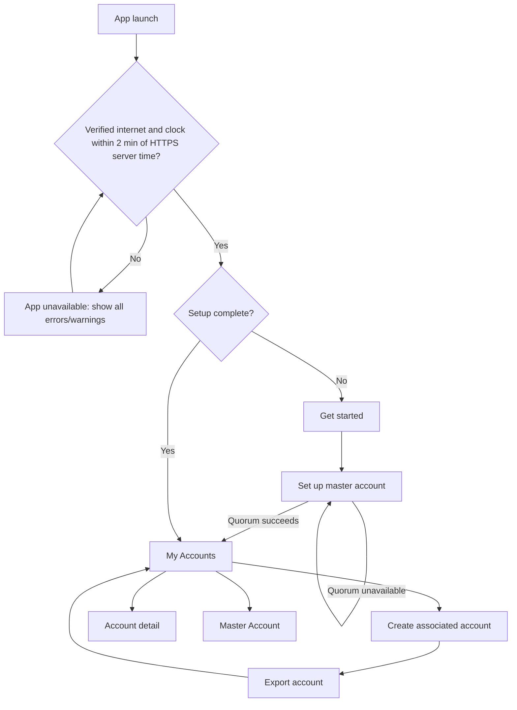

# Screens and states

This screen map reflects the current Android proof-of-concept navigation. The app always uses its dark visual theme; it does not follow the device's light or dark preference and offers no theme switcher.

## Visual palette

The fixed dark theme uses the approved palette throughout Compose UI and the launcher icon: primary `#D9D9D9`, accent `#3A3A3A`, surface `#232323`, background `#121212`, error `#F36262`, and success `#62F3B6`. Success is exposed as an app-specific semantic color. Text and accessible state labels continue to identify status without relying only on color.

| Screen | Purpose | Main action | Important states |
| --- | --- | --- | --- |
| App unavailable | Block vault navigation until safe remote-backup prerequisites are restored | Check again | No verified internet, device clock differs from HTTPS server time by over two minutes, or both |
| Get started | Introduce setup | Import SSH key | New installation |
| Set up master account | Import master private key/passphrase and establish quorum | Create or retry backup | Validating, quorum success, relay quorum missing, Brave quorum missing |
| My Accounts | List associated accounts and reach master details | Add account; open account; open Master Account | Loading, empty, recovering, populated |
| Create associated account | Generate a local-first account | Create account | Ready, creating, local success, scheduling error |
| Export account | Require an Android Sharesheet export before account use | Export to Notes | Chooser open |
| Account detail | Inspect account identity and per-source backup state | Consolidate backup | Missing, source checking/writing/present/missing/failed/unknown |
| Master Account | Inspect master and per-source backup state | Retry/consolidate as available | Quorum/status rows, checking, partial, failure |

The former global **Backup Status** screen and navigation destination have been removed. Backup information is attached to the account it describes.

## App unavailable

The app does not expose vault navigation until it has a system-validated internet connection and its clock is within two minutes of HTTPS server time. A captive portal or a merely connected local network is not sufficient. The app makes `HEAD` requests to Google and Cloudflare in order, uses their HTTP `Date` response header, and offsets the server value by half the request round-trip time. The first usable response is compared with the device clock. If neither source can provide time, the app does not claim that the clock is wrong and allows navigation once internet is validated. The blocking screen lists every proven unmet prerequisite, explains that incorrect time can invalidate backup authentication, and provides a **Check again** action. It rechecks on launch, resume, network changes, and manually.

## Navigation map

## Review notes

### Set up master account

- The screen accepts a passphrase-protected Ed25519 OpenSSH master key.
- On remote quorum failure, the imported master remains securely stored and retry does not require re-entry.
- Errors distinguish missing relay versus Brave coverage without including secret data.
- The screen remains protected from screenshots where supported.

### My Accounts

- Associated accounts only are listed as routine accounts; the screen has no top app bar, title, or explanatory header.
- A full-width, surface-colored outlined Master Account button opens master source status. The high-contrast add-account floating action remains in the bottom-right corner. Associated accounts are grouped by month with a centered month label between horizontal separators.
- Each account is a tappable neutral card showing a user-avatar icon followed by its fetched Nostr profile display name in 20sp regular text with `#E5E5E5`; names longer than 16 characters show their first 16 characters followed by `...`, and a missing or unavailable display name falls back to the shortened npub. The card also shows a 16-digit ID rendered as four evenly distributed four-digit groups in 32sp semi-bold text with `#FFFFFF`, and a right-aligned localized creation date/time in 14sp regular text with `#B6B6B6`. These styles inherit the app's default font family. The add-account floating action remains in the bottom-right corner.
- Automatic restoration occurs during consolidation; valid missing accounts appear after secure local persistence.

### Create associated account

- The screen requests the master-account passphrase and blocks creation unless it matches the securely retained passphrase. The field is obscured and the screen prevents screenshots where Android supports it.
- The account is stored locally before remote backup begins.
- Remote failures do not remove or disable the account.
- The UI should make clear that source backup may continue in the background.

### Local account backup

- Back navigation is blocked until the required backup route completes.
- The export screen sends the encrypted OpenSSH private key as plain text through the Android Sharesheet, allowing targets such as Keep, Messages, or email. The app considers this step complete after the chooser opens and the user confirms that the encrypted key was saved.
- This is sensitive shared-media/share-target output, despite OpenSSH passphrase encryption. The screen is protected from screenshots where Android supports it.

### Account detail and Master Account

Account detail reuses the same account summary card shown in the account list, without list-navigation click behavior. A separate card below it shows the account's full NIP-19 `npub` in emphasized body text, a medium-weight **Nostr identity** heading, and an accessible copy icon at the top right that copies only the public npub. Each fixed source has its own card with the endpoint as its title and a right-aligned icon-and-text state row: backed up, missing, checking, backing up, failed, or unknown. Internally, both a source-acknowledged write and a later read-confirmed copy display as **Backed up**; read-back is a reconciliation detail rather than a pending user action. Backed-up rows show the last successful backup time. Associated-account details provide **Consolidate backup** rather than a blind retry-write action: sources are checked first, only that account is reconciled, and existing canonical account IDs are not written again. The Master Account screen does not disclose its SSH public key and shows exactly one primary action: **Retry master setup** while quorum setup is incomplete, or **Consolidate backups** for the whole vault after setup completes. State must have textual/accessibility meaning rather than color alone. Timestamps may be shown, but secret payloads and authentication details must never appear.

## States requiring client approval

Before release, review final wording and behavior for quorum failure/retry, offline account creation, automatic restoration, partial and unknown source coverage, source authentication failure, and account-not-found handling.
