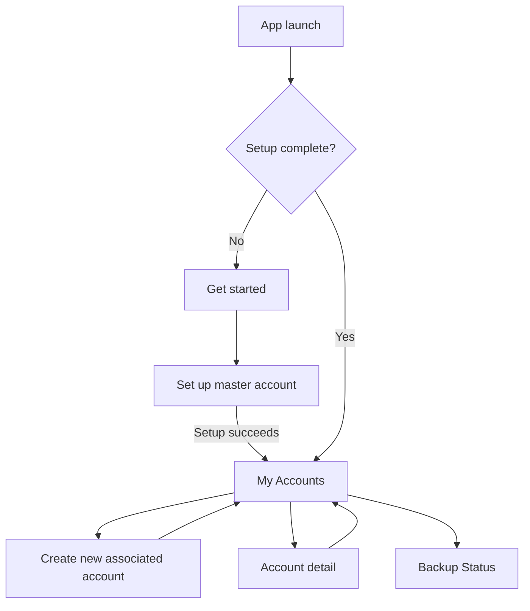

# Screens and states

This screen map reflects the Android proof-of-concept navigation. It is a review aid, not final visual design. Add approved screenshots or wireframes beside each section as the UI matures.

| Screen | Purpose | Main action | Important states |
| --- | --- | --- | --- |
| Get started | Introduce setup | Start setup | New installation |
| Set up master account | Provide master account private key and passphrase | Create and back up master account | Validating, setup in progress, invalid input, backup failure |
| My Accounts | List generated associated accounts | Add account; open account; open backups | Loading, empty, recovering, populated |
| Create new associated account | Confirm generation of a new account | Create account | Ready, creating, creation error |
| Account detail | Inspect one associated account | Show/copy private key | Account missing, normal, sensitive-key confirmation, sensitive-key view |
| Backup Status | View backup coverage | Sync now | No status yet, syncing, destination present/missing/unknown/repair failed |

## Navigation map

## Review notes by screen

### Set up master account

- The user pastes the master account private key and enters its passphrase.
- The screen must not echo secret values in an error message.
- The action remains unavailable while setup is running.
- The app protects this screen from screenshots on supported Android devices.
- Current proof-of-concept copy refers to protected remote backup; final stakeholder copy should avoid unexplained protocol names.

### My Accounts

- Only generated associated accounts appear in the routine list; the master account is intentionally not listed as a normal account.
- An empty state directs the user to create their first associated account.
- While backup discovery runs, the user receives a clear progress or outcome message. Every valid discovered associated account is restored automatically.
- The current proof of concept displays creation IDs as labels. Any friendlier naming feature requires a separate approved product decision.

### Create new associated account

- Explain that a new SSH key pair will be generated.
- Make clear that the account is stored locally first and backups may continue afterward.
- Provide a visible creation failure and a safe way to cancel.

### Account detail and private-key confirmation

- Public-key information and fingerprint are shown in the normal state.
- Private-key disclosure requires an immediate confirmation.
- The confirmation warns that anyone with the private key can use that account.
- The private-key view must be treated as sensitive: prevent screenshots where supported and avoid exposing content through notifications/logging.

### Backup Status

- The screen shows the master account and each associated account with coverage across configured backup destinations.
- **Present** means the app has confirmed the destination contains a copy.
- **Missing** means the app did not confirm a copy at that destination.
- **Unknown** means the app does not have sufficiently current information; it is not the same as failure.
- **Repair failed** means a repair attempt did not succeed and should lead to a clear retry/help message in the production UI.

## States that require client approval

Before release, stakeholders should review final content and behavior for:

- wrong passphrase and invalid-key messages;
- initial backup unavailable during setup;
- offline creation and later backup retry;
- automatic restoration when accounts are discovered during recovery;
- no accounts discovered during recovery;
- partial versus unknown backup coverage;
- account-not-found behavior; and
- private-key warning and copy feedback.
