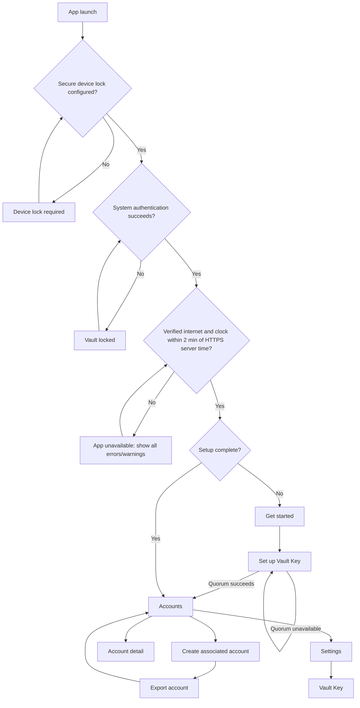

# Screens and states

This screen map reflects the current Android proof-of-concept navigation. The app always uses its dark visual theme; it does not follow the device's light or dark preference and offers no theme switcher.

## Visual palette

The fixed dark theme uses the design team's Material 3 palette, generated from the approved brand colors (seed `#D9D9D9`, error `#F36262`, success `#62F3B6`) and then overridden with the exact approved values where Material's generated tones differed. The visible result is the approved palette: primary `#D9D9D9`, background and base surface `#121212`, cards and raised surfaces `#232323`, accent and borders `#3A3A3A`, primary text `#FFFFFF` with secondary text `#B6B6B6`, error `#F36262`, and success `#62F3B6`. Success is exposed as an app-specific semantic color, as is the vault-key flow's link blue, because Material has no equivalent role. Text and accessible state labels continue to identify status without relying only on color.

The palette also includes light, medium-contrast, and high-contrast variants. They are defined but not selectable today: the app still ships only the standard-contrast dark theme, and the extra variants exist so a future accessibility setting can enable them without a redesign. Those accessibility variants intentionally keep Material's generated colors rather than the brand overrides, so their contrast guarantees hold. The launcher icon keeps its own approved brand colors (`#D9D9D9` plate, `#3A3A3A` mark).

| Screen | Purpose | Main action | Important states |
| --- | --- | --- | --- |
| Vault locked | Require Android device authentication before any vault navigation | Unlock | Prompt active, cancelled, failed, or retry available |
| Device lock required | Block use until a secure device lock is configured | Open security settings; check again | No accepted device credential configured |
| App unavailable | Block vault navigation until safe remote-backup prerequisites are restored | Check again | No verified internet, device clock differs from HTTPS server time by over two minutes, or both |
| Get started | Introduce the vault and offer first-run entry paths | Login with VaultKey | New installation; unimplemented action tapped ("coming soon") |
| Set up Vault Key | Import Vault Key private key/passphrase and establish quorum | Create or retry backup | Validating, quorum success, relay quorum missing, Brave quorum missing |
| Accounts | List associated accounts and reach app settings | Create account; open account; open Settings | Loading, empty, recovering, populated |
| Settings | Provide vault-management entry points and SSH key-generation controls | Open Vault Key; choose KDF rounds | Ready |
| Create associated account | Generate a local-first account | Create account | Ready, creating, local success, scheduling error |
| Export account | Require a verified text export before account use | Choose an app to save key; paste saved key to confirm | In-app app picker open, no compatible apps, launch rejected, paste malformed/mismatched/unreadable/empty |
| Account detail | Inspect account identity and per-source backup state | Consolidate backup | Missing, source checking/writing/present/missing/failed/unknown |
| Vault Key | Inspect Vault Key and per-source backup state | Retry/consolidate as available | Quorum/status rows, checking, partial, failure |

The former global **Backup Status** screen and navigation destination have been removed. Backup information is attached to the account it describes.

## Vault lock

A cold start or process restart always requires Android's system authentication prompt. Strong biometrics and the device PIN, pattern, or password are accepted. Cancelling or failing leaves a stable locked screen with an **Unlock** action; navigation is never rendered behind it. An unlocked session has a 30-second background grace period, measured with monotonic elapsed time. Returning after that interval requires authentication again.

If the device has no accepted secure lock, the app instead presents **Set up a device screen lock**, with actions to open Android security enrollment and check again. There is no skip path. Prompt errors that mean the device cannot satisfy the policy also route here, while cancellation and lockout remain on the locked screen. The whole activity prevents screenshots, screen recording, and sensitive Recents previews where Android supports it. This is an interactive lock screen only: it does not restrict background backup work or the signature-protected KeyHive provider.

## App unavailable

The app does not expose vault navigation until it has a system-validated internet connection and its clock is within two minutes of HTTPS server time. A captive portal or a merely connected local network is not sufficient. The app makes `HEAD` requests to Google and Cloudflare in order, uses their HTTP `Date` response header, and offsets the server value by half the request round-trip time. The first usable response is compared with the device clock. If neither source can provide time, the app does not claim that the clock is wrong and allows navigation once internet is validated. The blocking screen lists every proven unmet prerequisite, explains that incorrect time can invalidate backup authentication, and provides a **Check again** action. It rechecks on launch, resume, network changes, and manually.

## Navigation map

## Review notes

### Get started

- The screen shows the ZenTen brand mark on a circular themed plate, a welcome title, and a short purpose description.
- **Create VaultKey** opens the Create VaultKey wizard, whose implemented screens collect consent and a passphrase, verify the passphrase, generate the VaultKey, export it as the first local Vault Backup, and verify the exported copy by pasting it back.
- **Login with VaultKey** is the only implemented action and opens **Set up Vault Key** to import an existing Ed25519 OpenSSH key. It uses a neutral raised surface rather than the primary action color to show its secondary visual priority.
- An "or continue with" separator precedes **Google**, **Apple**, and **Microsoft** buttons. Each has a right-aligned **Coming soon** label and is disabled because these providers are not implemented.
- Every unimplemented action shows a short "coming soon" snackbar naming the action. A new message replaces any visible one, so repeated taps do not queue up.
- All colors come from the app theme. Multi-color third-party brand marks are the deliberate exception: their colors live inside the vector assets because brand guidelines forbid recoloring. The monochrome ZenTen and Apple marks are tinted from the theme.
- The content scrolls vertically so short screens cannot clip the buttons.

### Create VaultKey wizard

- All wizard steps share one page frame: a top-left blue **< Back** link, a centered hero illustration, a centered title, step content, and a bottom-anchored action button. Each step supplies its own illustration (pen-and-paper for **Getting Started**, a padlock for **Create Passphrase**, a padlock inside a repeat arrow for **Re-enter Passphrase**, a safe with a combination dial for **Create Backup**, and the confirmation artwork for **Confirm Backup**); all are scaled to fit the same square footprint so the title does not shift between steps, and each has a screen-reader description because the artwork conveys what the step is about. These illustrations are multi-tone line art whose colors live in the vector assets rather than being tinted from the theme, which is safe because the app always renders its dark scheme. Each page scrolls so a short screen cannot clip the button. Supporting copy is not part of the shared frame; each step supplies its own if it needs one.
- When the soft keyboard opens on a passphrase step, the page frame shrinks by the keyboard height rather than sliding beneath it, so the action button (**Confirm** or **Verify**) moves up and stays visible and tappable above the keyboard while the upper content remains scrollable.
- Step 1 (**Getting Started**) shows the unrecoverable-loss warning and the consent checkbox that gates **Confirm**.
- Step 2 (**Create Passphrase**) shows an unlabeled passphrase field obscured by default with an eye toggle. Below it, a compact, borderless two-column grid shows the five requirements: at least 8 characters, one uppercase letter, one lowercase letter, one number, and one non-whitespace special character. A newly completed rule gains a success check and success color for two seconds, then leaves the grid so only unmet rules remain. Once all five are satisfied, **Confirm** appears; the policy is checked again before the passphrase is retained.
- Step 3 (**Re-enter Passphrase**) likewise shows only its title and an unlabeled passphrase field with the same eye toggle. **Verify** is enabled once text is entered. It compares this entry with the passphrase chosen in step 2:
  - If they differ, an inline red message asks the user to re-enter the chosen passphrase and nothing is created, so a typo in an unrecoverable secret cannot be baked into a key. The message clears as soon as the field is edited again.
  - If they match, the app generates a new Ed25519 OpenSSH VaultKey encrypted with that passphrase. While this runs the action is inert and reads **Creating VaultKey…**, because the passphrase-to-key derivation is deliberately slow. On success the wizard advances to step 4; on failure a generic retry message is shown that never echoes key or passphrase material.
- After a passphrase match, the non-dismissible **Creating VaultKey** screen shows a terminal-style transcript. Each line continuously churns as safe random glyphs while its real operation runs, then resolves when complete: encrypted VaultKey creation, Nostr key-pair derivation, Sync Code derivation, and each configured Nostr Relay or Sync Server backup attempt in order. Completed lines remain visible, while accessibility services receive a neutral progress status instead of the glyphs. After every attempt finishes, a circular checkmark and **VaultKey created successfully** remain visible for two seconds before the wizard advances. Disabling system animations skips visual churn.
- Step 4 (**Create Backup**) explains that the first Vault Backup is a digital backup the user must store safely themselves, for example in a preferred encrypted notes app, and repeats the unrecoverable-loss warning directly above the action. **Export VaultKey** opens the same direct installed-app target picker used for associated-account local backup, exports the encrypted OpenSSH key in the same self-describing text format (PEM markers around a single-line Base64 body, then the `npub`, raw creation ID/timestamp, the fixed `VaultKey` display name, and the account-card-style `Created on ...` date), records **Confirm Backup** as the durable resume point, and advances there after Android accepts the target intent.
- Step 5 (**Confirm Backup**) tells the user to upload the safely stored backup and offers **Paste VaultKey**. It reads and immediately clears the clipboard like the import flow, validates a supported encrypted Ed25519 OpenSSH key, and verifies that it exactly matches the generated VaultKey. Errors never display secret material. The user may go back to **Create Backup** and export again.
- Step 6 (**Save your Secret Combinations**) shows the 24 one-based English BIP-39 word-list indices of the Vault Key-derived Brave Sync mnemonic in eight numbered rows (1–8) of three. A compact warning tells the user to write down all eight combinations, store them offline, and that Vault cannot restore lost combinations; a separate prompt makes clear that the picker scrolls to reveal all eight. Only the three-row combinations picker scrolls: it sits near the screen’s visual center, snaps the active row to the center as an elevated card at full opacity, fades adjacent cards directionally toward the picker edges, and lets the first and last rows center without looping. The short acknowledgement and **Continue** action remain anchored at the bottom. The values can be hidden, screenshots are blocked, and **Continue** is gated by acknowledgement that all eight combinations were saved.
- Step 7 (**Secret Combinations**) verifies the create-flow transcription by requiring all 24 indices again in the same eight labeled rows. Input is strictly sequential because the expected values are available locally during creation.
- **Recover VaultKey — Secret Combinations** uses the same three-row visual viewport but supports recovery-oriented editing: users can scroll all eight snapping rows, tap and revise any field, and use keyboard **Next** navigation. Four-digit values advance automatically without locking earlier fields. A persistent **Continue** action validates all values together; missing or out-of-range fields receive red borders, while checksum failure produces a combination-level message because BIP-39 cannot identify the mistyped field. Entries remain available for correction.
- Steps 1, 4, and 7 have descriptive body copy.
- Both passphrase steps prevent screenshots and screen recording where Android supports it. The chosen passphrase and the generated VaultKey exist only in the wizard's in-memory state; they are never placed in a navigation argument or in storage, and they are discarded when the wizard leaves the back stack. Changing the passphrase after a key was generated discards that key.
- The passphrase fields use the password keyboard type so the platform keyboard does not learn or suggest secret material.

### Set up Vault Key

- The screen accepts a passphrase-protected Ed25519 OpenSSH vault key.
- **Setup VaultKey Account** uses a two-segment progress indicator for its two steps. The first step shows a **Paste VaultKey** action instead of a key text field and an outlined **Cancel** action. It reads the clipboard, clears the current clipboard entry, and validates the encrypted OpenSSH-v1 Ed25519 container without rendering it. PEM, raw Base64, and the supported JSON wrapper are accepted; clipboard or key-format errors remain on the first step with a safe message.
- On remote quorum failure, the imported Vault Key remains securely stored and retry does not require re-entry.
- Errors distinguish missing relay versus Brave coverage without including secret data.
- The screen remains protected from screenshots where supported.

### Accounts

- Associated accounts only are listed as routine accounts. A centered **Accounts** title identifies the landing screen, which intentionally has no Back action.
- The top-right settings cog opens **Settings**. A labeled, high-contrast **Create New Account** button is centered at the bottom over a subtle background gradient and shadow. Associated accounts are grouped by month with a centered month label between horizontal separators.
- Each account is a tappable neutral card showing a user-avatar icon followed by its fetched Nostr profile display name in 20sp regular text with `#E5E5E5`; the name uses the available row width and is ellipsized only when it exceeds that width. A missing or unavailable display name falls back first to the persisted account name and then to the shortened npub. The card also shows a 16-digit ID rendered as four evenly distributed four-digit groups in 32sp semi-bold text with `#FFFFFF`, and a right-aligned localized creation date/time in 14sp regular text with `#B6B6B6`. These styles inherit the app's default font family.
- Automatic restoration occurs during consolidation; valid missing accounts appear after secure local persistence.

### Settings

- Settings uses a centered title and a Back action that returns to **Accounts**.
- The current vault section contains one full-width **Vault Key** item with supporting text. It opens Vault Key source status and Vault Key consolidation controls.
- **KDF rounds** is a dropdown for the bcrypt work factor used by newly generated Vault Keys and associated SSH accounts. It permits only `1`, `2`, `4`, `8`, `16`, `32`, `64`, `128`, `256`, `512`, `1024`, `2048`, `4096`, or `8192`, defaults to `128`, and does not alter existing encrypted keys.

### Create associated account

- The screen requests the vault-key passphrase and blocks creation unless it matches the securely retained passphrase. The field is obscured and the screen prevents screenshots where Android supports it.
- The account is stored locally before remote backup begins.
- Remote failures do not remove or disable the account.
- The UI should make clear that source backup may continue in the background.

### Local account backup

- Back navigation is blocked until the required backup route completes.
- The export screen sends the encrypted OpenSSH private key as plain text to a chosen app, allowing targets such as Keep, Messages, or email. After the target opens, the screen asks the user to copy the saved key back and paste it in. The app reads the clipboard, clears the current clipboard entry, and checks that the pasted encrypted key matches the account; only a match completes the step. Malformed, mismatched, unreadable, or empty pastes show a safe error and keep the screen active, and the app cannot verify that the receiving app actually retained a durable copy.
- This is sensitive shared-media/share-target output, despite OpenSSH passphrase encryption. The screen is protected from screenshots where Android supports it.

### Account detail and Vault Key

The Vault Key screen uses a centered title and a Back action that returns to **Settings**. The account-detail screen likewise uses a centered title with a Back action that returns to **Accounts**, and reuses the same account summary card shown in the account list without list-navigation click behavior. A separate card below it shows the account's full NIP-19 `npub` in emphasized body text, a medium-weight **ID on NOSTR protocol** heading, and an accessible copy icon embedded immediately after the value in the same text element. Tapping that text element copies the public npub. Another card below it shows the SSH public-key line with the same inline copy icon and tap-to-copy behavior, with its comment set to the account's `npub`. A further card below it shows the SHA-256 SSH public-key fingerprint with the same inline copy icon and tap-to-copy behavior, followed by the bcrypt KDF round count stored in the encrypted OpenSSH key. Each fixed source has its own card with the endpoint as its title and a right-aligned icon-and-text state row: backed up, missing, checking, backing up, failed, or unknown. Internally, both a source-acknowledged write and a later read-confirmed copy display as **Backed up**; read-back is a reconciliation detail rather than a pending user action. Backed-up rows show the last successful backup time. Associated-account details provide **Consolidate backup** rather than a blind retry-write action: sources are checked first, only that account is reconciled, and existing canonical account IDs are not written again. The Vault Key screen does not disclose its SSH public key and shows exactly one primary action: **Retry Vault Key setup** while quorum setup is incomplete, or **Consolidate VaultKey backup** after setup completes. That action reconciles the Vault Key record only. State must have textual/accessibility meaning rather than color alone. Timestamps may be shown, but secret payloads and authentication details must never appear.

## States requiring client approval

Before release, review final wording and behavior for quorum failure/retry, offline account creation, automatic restoration, partial and unknown source coverage, source authentication failure, and account-not-found handling.
