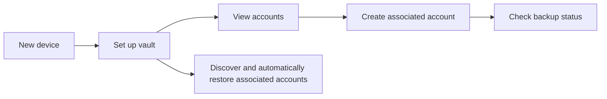

# User journeys

These journeys describe the user-facing intent for review. Exact text and visuals may change, but the decisions, safeguards, and outcomes should remain consistent.

## 0. Enter the vault

**User goal:** Open ZenTen Vault securely.

1. The app verifies that the device has a secure PIN, pattern, password, or supported biometric lock.
2. If no lock exists, the app blocks all use and links to Android security settings. It rechecks when the user returns.
3. Otherwise Android asks for a strong biometric or the device PIN, pattern, or password.
4. Successful authentication continues to the internet/time prerequisite check and then the appropriate vault screen. Cancellation or failure remains locked.
5. The app requires authentication again after 30 seconds in the background. Cold starts and process restarts always require it.

**Success:** No interactive vault content is available before device authentication.

## 1. First-time setup

**User goal:** Start a vault using an existing Vault Key.

**Starting point:** The app is new.

1. The user selects **Login with VaultKey** on **Get started**, copies the Ed25519 OpenSSH private key, selects **Paste VaultKey**, and then enters its passphrase in step two. The key is not displayed, and the app clears the current clipboard entry before advancing. **Create VaultKey** opens a wizard that collects consent and a passphrase, verifies the re-entered passphrase, generates and stores an encrypted VaultKey, exports it through an installed text-capable app, asks the user to paste it back to confirm the stored backup, and presents the `vkbckp` (Vault Key BacKup) recovery mnemonic as grouped BIP-39 indices for offline transcription, then requires each index to be re-entered sequentially to verify the copy. Setup completes after that verification only when the VaultKey also reached its remote backup quorum, meaning at least one relay and one Brave Sync server hold a copy; otherwise the final screen explains the missing remote copy and offers a retry. The federated options (Google, Apple, Microsoft) are not implemented and report "coming soon".
2. The app validates the material locally and prepares the vault identity.
3. The app creates the required initial protected backup and reports progress.
4. When setup succeeds, the user reaches **Accounts**.
5. The app looks for associated accounts already available from backup and restores every valid discovered account automatically.

**Success:** The vault is ready for use, and any valid discovered associated accounts are added to **Accounts**.

**Important failure behavior:** An invalid key or wrong passphrase is explained without displaying the supplied secret. If the required initial backup cannot be confirmed, setup remains incomplete and the user can retry rather than being told the vault is ready. This applies to both the imported-key path and the in-app generation wizard, which keeps the user on its final verification screen until a retry reaches quorum.

## 2. Create an associated account

**User goal:** Create a separate credential for a new service, project, or environment.

**Starting point:** Setup is complete and the required Vault Key backup quorum has been satisfied.

1. The user selects **Create New Account** from the bottom center of **Accounts**.
2. The app asks for the **VaultKey Passphrase**, which the user can show or hide, and verifies it before continuing.
3. The app asks for a mandatory **Account Name** containing 3 to 128 characters.
4. The user selects **Create Account**, or uses the header back arrow to return without creating one.
5. The app confirms that Vault Key backup quorum is satisfied and that fewer than 99 associated accounts already exist; otherwise creation stops without saving an account. (The 99-account ceiling does not limit accounts restored from backup.)
6. The app saves the new associated account and its name on the device first. The name is also carried on the account's backup records — the plain `label` tag on its kind 37802 relay event and the `label: <name>` note on its Brave Sync record — so automatic recovery restores it; nothing is published as a Nostr profile.
7. The app starts background consolidation, checking each destination before writing only confirmed gaps.
8. The user exports the encrypted OpenSSH private key to Notes, Messages, or another available app, then copies the saved key back and pastes it into the export screen.
9. The app confirms the pasted key matches the account and clears the clipboard before the user returns to the account list and can check backup status.

**Success:** The new associated account is available locally after the required local-backup step completes, even if remote consolidation must run again later.

## 3. Inspect an associated account

**User goal:** Review an associated account's identity and backup coverage.

1. The user opens an account from **Accounts**.
2. The app shows the account ID, creation time, SSH public-key line, SSH public-key fingerprint, and the bcrypt KDF round count stored in the encrypted SSH key. The user can copy any public identifier by tapping its text element, which includes an inline copy icon. The account's Nostr identity stays internal: its NIP-19 `npub` is not shown, copied, or exported, and the SSH public-key line carries no comment.
3. The app lists each configured backup destination and its current status.
4. The user can select **Consolidate backup** to reconcile that account.
5. The user can also export the account's private key in its passphrase-encrypted form. **Export Account to Notes** asks the user to re-enter the passphrase that protects the account, then opens the in-app target picker and sends the same self-describing encrypted-key text used when the account was created. **Export Account to Clipboard** uses the same passphrase gate and copies just the encrypted key as an OpenSSH PEM block, without the account metadata, and confirms with a status line.

**Success:** The user can review account identity, its public SSH key and fingerprint, and backup coverage without plaintext private-key material appearing on screen.

**Safety expectation:** Account detail must not expose or copy plaintext SSH private keys. The displayed and tap-to-copy values remain only the SSH public-key line and SHA-256 SSH fingerprint; the account's NIP-19 `npub` is neither shown nor copied. The two voluntary exports are the only actions that release key material: each requires the user to re-enter the account passphrase, and each emits only the passphrase-encrypted OpenSSH key, which is never rendered in plaintext in the app.

## 4. Check and consolidate backup status

**User goal:** Understand whether an account has known backup coverage.

1. The user opens an account, or opens **Settings** and selects **Vault Key**.
2. The app lists each configured destination and its current status.
3. From an associated-account screen, the user selects **Consolidate backup** to reconcile only that account. From the Vault Key screen, the user selects **Consolidate VaultKey backup** to reconcile only the Vault Key record. Associated accounts are reconciled automatically once after each passphrase-unlocked launch; there is no hourly background schedule.
4. The app checks every source before writing and does not push an account to a source that already reports its canonical ID. Full-vault consolidation can also restore valid missing local accounts; targeted consolidation does not process unrelated accounts.
5. The user sees whether each destination is backed up, missing, unknown, or needs attention.

**Success:** The user can identify a backup concern and safely consolidate when a remote destination or network becomes available.

## 5. Set up on a new device and recover accounts

**User goal:** Rebuild access to previously generated associated accounts after losing or replacing a device.

1. The user installs the app on a new device.
2. The user completes setup using the same Vault Key private key and passphrase, or by recovering it with the 24 saved Secret Combinations and passphrase.
3. The app uses that identity to look for protected backup copies.
4. Every valid discovered associated account is restored automatically.
5. Restored accounts appear in **Accounts** and are available locally.

**Success:** The user regains all valid discovered associated accounts when usable remote backups can be found.

**Important limitation:** This journey restores associated accounts, not Vault Key material. The Vault Key itself is rebuilt only if the user still has one of two things — the private key, or the 24 Secret Combinations plus a remote copy — *and* the passphrase on every path. A forgotten passphrase cannot be reset or recovered; see [what users must retain](backup-and-recovery.md#what-users-must-retain).

## 6. Rewrite and verify the VaultKey Secret Combinations

**User goal:** Write down a fresh offline copy of the VaultKey's 24 recovery word positions from a configured device.

1. The user opens **Settings** and selects **Secret Combinations**.
2. The app asks for the passphrase that protects the VaultKey before showing anything. A wrong passphrase shows an inline error and no combination.
3. Once the passphrase matches, the app displays the 24 one-based BIP-39 positions in eight rows of three and asks the user to write them down and store them offline.
4. The user acknowledges that all eight combinations were saved and continues.
5. The app requires all 24 positions again, one segment at a time, to prove the written copy is accurate.
6. After every value matches, the app confirms success and returns to **Settings**.

**Success:** The user holds an independently written copy of the VaultKey Secret Combinations and has verified it against the vault.

**Safety expectation:** The combinations are shown only after the VaultKey passphrase is verified. Once that gate passes the flow cannot be cancelled or skipped, and the app reopens the unfinished step after a restart. A wrong verification segment is corrected in place; system Back returns to the displayed combinations and never escapes the flow.
