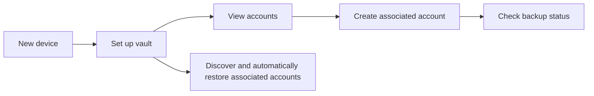

# User journeys

These journeys describe the user-facing intent for review. Exact text and visuals may change, but the decisions, safeguards, and outcomes should remain consistent.

## 1. First-time setup

**User goal:** Start a vault using an existing Vault Key.

**Starting point:** The app is new.

1. The user selects **Login with VaultKey** on **Get started**, copies the Ed25519 OpenSSH private key, selects **Paste VaultKey**, and then enters its passphrase in step two. The key is not displayed, and the app clears the current clipboard entry before advancing. **Create VaultKey** opens a wizard that collects consent and a passphrase, verifies the re-entered passphrase, generates and stores an encrypted VaultKey, exports it through an installed text-capable app, asks the user to paste it back to confirm the stored backup, and presents the Brave recovery mnemonic as grouped BIP-39 indices for offline transcription, then requires each index to be re-entered sequentially to verify the copy. Setup still cannot complete because the post-verification step is not implemented. The federated options (Google, Apple, Microsoft) are not implemented and report "coming soon".
2. The app validates the material locally and prepares the vault identity.
3. The app creates the required initial protected backup and reports progress.
4. When setup succeeds, the user reaches **Accounts**.
5. The app looks for associated accounts already available from backup and restores every valid discovered account automatically.

**Success:** The vault is ready for use, and any valid discovered associated accounts are added to **Accounts**.

**Important failure behavior:** An invalid key or wrong passphrase is explained without displaying the supplied secret. If the required initial backup cannot be confirmed, setup remains incomplete and the user can retry rather than being told the vault is ready.

## 2. Create an associated account

**User goal:** Create a separate credential for a new service, project, or environment.

**Starting point:** Setup is complete and the required Vault Key backup quorum has been satisfied.

1. The user selects **Create New Account** from the bottom center of **Accounts**.
2. The app asks for the **VaultKey Passphrase**, which the user can show or hide, and verifies it before continuing.
3. The app asks for a mandatory **Account Name** containing 8 to 128 characters.
4. The user selects **Create Account**, or selects **Cancel** to return without creating one.
5. The app confirms that Vault Key backup quorum is satisfied and that fewer than 99 associated accounts already exist; otherwise creation stops without saving an account. (The 99-account ceiling does not limit accounts restored from backup.)
6. The app saves the new associated account and its name on the device first.
7. The app starts background consolidation, checking each destination before writing only confirmed gaps.
8. The user exports the encrypted OpenSSH private key through the device Sharesheet to Notes, Messages, or another available app. The account name is later published publicly as its Nostr profile `display_name`.
9. The user returns to the account list and can check backup status.

**Success:** The new associated account is available locally after the required local-backup step completes, even if remote consolidation must run again later.

## 3. Inspect an associated account

**User goal:** Review an associated account's identity and backup coverage.

1. The user opens an account from **Accounts**.
2. The app shows the account ID, creation time, NIP-19 `npub` identity, SSH public-key line, SSH public-key fingerprint, and the bcrypt KDF round count stored in the encrypted SSH key. The user can copy any public identifier by tapping its text element, which includes an inline copy icon.
3. The app lists each configured backup destination and its current status.
4. The user can select **Consolidate backup** to reconcile that account.

**Success:** The user can review account identity, its public SSH key and fingerprint, and backup coverage without private-key material appearing on screen.

**Safety expectation:** Account detail must not expose or copy SSH private keys. Its copy actions copy only the displayed public NIP-19 `npub`, SSH public-key line, or SHA-256 SSH fingerprint.

## 4. Check and consolidate backup status

**User goal:** Understand whether an account has known backup coverage.

1. The user opens an account, or opens **Settings** and selects **Vault Key**.
2. The app lists each configured destination and its current status.
3. From an associated-account screen, the user selects **Consolidate backup** to reconcile only that account. From the Vault Key screen, the user selects **Consolidate VaultKey backup** to reconcile only the Vault Key record. Associated accounts are reconciled automatically at app startup and hourly.
4. The app checks every source before writing and does not push an account to a source that already reports its canonical ID. Full-vault consolidation can also restore valid missing local accounts; targeted consolidation does not process unrelated accounts.
5. The user sees whether each destination is backed up, missing, unknown, or needs attention.

**Success:** The user can identify a backup concern and safely consolidate when a remote destination or network becomes available.

## 5. Set up on a new device and recover accounts

**User goal:** Rebuild access to previously generated associated accounts after losing or replacing a device.

1. The user installs the app on a new device.
2. The user completes setup using the same Vault Key private key and passphrase.
3. The app uses that identity to look for protected backup copies.
4. Every valid discovered associated account is restored automatically.
5. Restored accounts appear in **Accounts** and are available locally.

**Success:** The user regains all valid discovered associated accounts when usable remote backups can be found.

**Important limitation:** The app cannot recover the Vault Key private key or its passphrase. If either is unavailable, this recovery path is unavailable.
