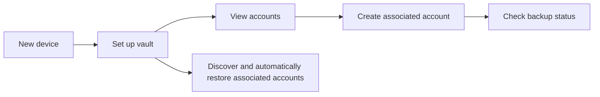

# User journeys

These journeys describe the user-facing intent for review. Exact text and visuals may change, but the decisions, safeguards, and outcomes should remain consistent.

## 1. First-time setup

**User goal:** Start a vault using an existing master account.

**Starting point:** The app is new.

1. The user selects **Get started**.
2. The user provides the Ed25519 OpenSSH private key and passphrase for their master account.
3. The app validates the material locally and prepares the vault identity.
4. The app creates the required initial protected backup and reports progress.
5. When setup succeeds, the user reaches **My Accounts**.
6. The app looks for associated accounts already available from backup and restores every valid discovered account automatically.

**Success:** The vault is ready for use, and any valid discovered associated accounts are added to **My Accounts**.

**Important failure behavior:** An invalid key or wrong passphrase is explained without displaying the supplied secret. If the required initial backup cannot be confirmed, setup remains incomplete and the user can retry rather than being told the vault is ready.

## 2. Create an associated account

**User goal:** Create a separate credential for a new service, project, or environment.

**Starting point:** Setup is complete and the required master backup quorum has been satisfied.

1. The user selects **Add account** or the add button from **My Accounts**.
2. The app explains that it will generate a fresh Ed25519 OpenSSH key pair.
3. The user selects **Create account**.
4. The app confirms that master backup quorum is satisfied; otherwise creation stops without saving an account.
5. The app saves the new associated account on the device first.
6. The app starts background consolidation, checking each destination before writing only confirmed gaps.
7. The user returns to the account list and can check backup status.

**Success:** The new associated account is available locally immediately, even if remote consolidation must run again later.

## 3. Inspect or copy an associated account key

**User goal:** Use an associated account's generated SSH key with another service.

1. The user opens an account from **My Accounts**.
2. The app shows the public key and fingerprint.
3. To see the private key, the user selects **Show private key**.
4. The app warns that anyone who sees the private key can use that account.
5. Only after confirmation does the app show the private key and offer copy.
6. The user closes the sensitive view when finished.

**Success:** The user can intentionally access the key without it appearing by default.

**Safety expectation:** Sensitive views should prevent screenshots where the device permits and should not expose private-key content in ordinary notifications or logs.

## 4. Check and consolidate backup status

**User goal:** Understand whether an account has known backup coverage.

1. The user opens an account or the dedicated Master Account screen.
2. The app lists each configured destination and its current status.
3. The user selects **Consolidate backups** (or **Consolidate now** for the master) to refresh coverage and repair confirmed gaps.
4. The app checks every source before writing, restores valid missing local accounts, and does not push an account to a source that already reports its canonical ID.
5. The user sees whether each destination is backed up, missing, unknown, or needs attention.

**Success:** The user can identify a backup concern and safely consolidate when a remote destination or network becomes available.

## 5. Set up on a new device and recover accounts

**User goal:** Rebuild access to previously generated associated accounts after losing or replacing a device.

1. The user installs the app on a new device.
2. The user completes setup using the same master account private key and passphrase.
3. The app uses that identity to look for protected backup copies.
4. Every valid discovered associated account is restored automatically.
5. Restored accounts appear in **My Accounts** and are available locally.

**Success:** The user regains all valid discovered associated accounts when usable remote backups can be found.

**Important limitation:** The app cannot recover the master account private key or its passphrase. If either is unavailable, this recovery path is unavailable.
