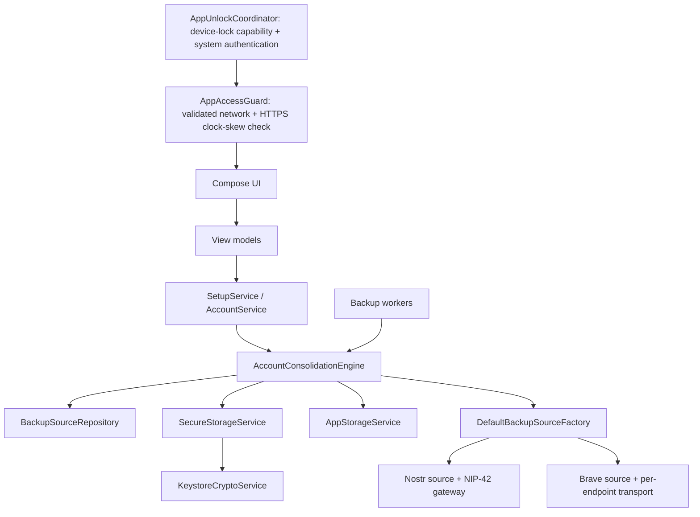

# Architecture overview

## Android application structure

The Compose theme and the Android launch-window theme are fixed to the app's dark palette. They deliberately do not read the system night-mode preference, preventing a light launch flash or a runtime theme change when the device setting changes.

The app's mark is defined once in `res/drawable/vault_app_icon.xml` (the vault shield glyph). The asset is cropped tightly to the glyph's own bounds (243.89 x 304.23 vector units, aspect 0.8017), so it is portrait and carries no transparent margin. The launcher icon uses it as its adaptive foreground — `res/drawable/ic_launcher_foreground.xml` applies per-side insets (`insetLeft`/`insetRight` 32.55dp, `insetTop`/`insetBottom` 27.24dp) that rebuild an inner box with the glyph's aspect ratio, so the shield renders at its previous ~53.5dp x ~42.9dp size and stays centred in the layer — over the `#121212` background color in `res/values/ic_launcher_background.xml`. The **Get started** screen draws the same asset on that same `#121212` background and sizes the mark to the same aspect ratio (`BrandMarkHeight` plus its 0.8017-derived width). The in-app logo and the launcher icon therefore cannot drift apart.

`ui/theme/Color.kt` is the design team's Material Theme Builder export (generated with `material-color-utilities` from seed `#D9D9D9` Monochrome, error palette `#F36262`, success `#62F3B6`). It holds every color value for the six generated schemes: light and dark, each in standard, medium, and high contrast. Design also applies the ZenTen brand overrides inside this file, on the standard dark scheme only, and marks each one `// ZenTen brand`; the medium- and high-contrast schemes keep Material's generated values so their contrast guarantees hold. Treat the file as a design-owned drop-in and re-import it wholesale rather than editing individual values.

`ui/theme/Theme.kt` maps those palette values onto Material color-scheme roles and owns the app-specific theme decisions: `ZenTenVaultTheme` defaults `darkTheme` to `true` instead of reading the system setting, never wires up Android 12+ dynamic (wallpaper) color so branding stays identical on every device, keeps system bar icon appearance in sync with the active scheme, and takes a `contrast` parameter that selects the medium/high schemes a stock export leaves unused. `LocalExtendedColors` supplies the roles Material lacks: `success` from the generated palette, and the vault-key flow's iOS-style `link` blue, which is defined in `Theme.kt` because it is not part of any tonal palette.

The dark palette sets `surface` equal to `background` (`#121212`), so `surface` no longer distinguishes a raised plate from the screen behind it. Raised elements use a `surfaceContainer*` role instead: `ui/components/VaultCard.kt` relies on Compose's `Card` default of `surfaceContainerHighest`, which the palette pins to the approved card color `#232323`. Highest-emphasis text uses `onSurface`, which the palette sets to `#FFFFFF`.

```text
app.zenten.vault
├── ui/           Compose screens, navigation, and view models
├── domain/       Source model, setup, account, backup, and consolidation orchestration
├── crypto/       SSH parsing, seed derivation, Nostr derivation, NIP-44
├── data/         Secure account storage and non-secret operational preferences
├── network/      Nostr relay transport, event encoding, and NIP-42 authentication
├── bravesync/    Brave Sync client, crypto, password records, and transport
├── background/   WorkManager targeted and post-unlock all-account consolidation and retry
└── di/           Hilt dependency injection
```

## Primary flow



## Source-oriented model

`BackupSourceConfig` represents one independently checked and written endpoint. Four fixed defaults are merged with persisted custom sources in stable order. The default entries are immutable in repository operations. Each source declares type, endpoint, ordering, enabled/restore/trust/quorum policy, and authentication mode.

`DefaultBackupSourceFactory` constructs one `AccountBackupSource` adapter per configuration. Nostr adapters address exactly one relay through `NostrRelayGateway`; Brave adapters construct `BraveSyncTransport` with exactly one configured server URL. Existing Nostr event and Brave password-record formats are preserved.

The current app has no custom-source management UI. The repository API is retained so a future UI can create and manage custom sources without reimplementing persistence, endpoint validation, ordering, or processing support.

## Serialization boundary

`AccountConsolidationEngine` owns one coroutine `Mutex` around Vault Key backup, account backup, pending retry, and consolidation. Within each operation it uses ordered loops and suspend calls without `async`, ensuring no intentional network concurrency across sources or accounts.

The engine exposes three scoped entry points: `backupVaultKey` (the Vault Key only), `consolidateAccount` (one associated account), and `consolidate` (all associated accounts, with restore). Vault Key reconciliation is separate from account consolidation because the two record classes are published under different Nostr identities; see [Encrypted backup](../features/encrypted-backup.md).

## Core lifecycle

1. **Vault Key setup:** persist Vault Key locally, inspect/write all sources sequentially, and complete setup only with one eligible Nostr plus one eligible Brave success. Retain the local Vault Key on quorum failure.
2. **Associated creation:** generate and save locally, then enqueue background backup; failed sources are persisted as pending IDs.
3. **Consolidation restore:** index every source and restore missing valid associated accounts from trusted sources.
4. **Consolidation backup:** use retained phase-1 indexes to fill gaps, then perform one final read-back per successfully indexed source.
5. **Status:** persist per-account/per-source state and coarse errors. UI observes this state in account and Vault Key details.

## Device-authentication gate

`MainActivity` applies `FLAG_SECURE` for its full lifetime and renders `AppUnlockCoordinator` as the outermost UI gate. The coordinator checks device-lock capability (the combined `BIOMETRIC_STRONG | DEVICE_CREDENTIAL` query on API 30+, the keyguard's `isDeviceSecure` signal below that), invokes AndroidX `BiometricPrompt`, and keeps successful unlock state only in memory. It records background time with `SystemClock.elapsedRealtime`; a return within 30 seconds retains the session, while the boundary or any later return relocks. Cold/process starts have no timestamp and therefore always authenticate. No configured lock fails closed into a setup screen that opens Android enrollment settings, and prompt errors are classified so capability failures route to enrollment while cancellation and lockout stay on the retryable locked screen. This gate protects interactive UI only. Background consolidation now requires the in-memory passphrase session that the gate unlocks and fails closed when it is locked; the signature-protected KeyHive provider retains its existing contract.

## App-entry safety gate

`RemoteOperationPrecondition` is the single prerequisite policy for timestamp-sensitive remote operations. It requires an active network with `NET_CAPABILITY_VALIDATED` (excluding captive portals and local-only connections) and a device clock within two minutes of HTTPS server time. It makes non-cached `HEAD` requests to `https://www.google.com/generate_204` and then `https://cloudflare.com`, parses the first usable HTTP `Date` header, and adjusts the result by half of the measured request round-trip time before comparing it to the wall clock. `AppAccessGuard` applies this policy on creation, resume, network changes, system clock/timezone changes (`ACTION_TIME_CHANGED`/`ACTION_TIMEZONE_CHANGED` via a non-exported receiver), and manual retry, replacing navigation with `AppBlockedScreen` for proven internet or clock-skew failures. `AccountConsolidationWorker`, `VaultKeyConsolidationWorker`, and `ProfilePublicationWorker` apply the same policy before producing timestamped remote data and retry when internet is not validated or clock skew is known bad. `SetupService` applies the same policy directly before its in-process Vault Key backup calls (`performSetup`, `retryVaultKeyBackup`, and the create-flow `persistGeneratedVaultKeyAndBackup`), and `VaultApplication` applies it before its startup consolidation, so user-reachable in-process work cannot sign timestamped Nostr events or Brave Sync tokens with a known-bad clock. If neither server is available or supplies a valid `Date` header, all paths continue because that failure cannot prove a device-time error. HTTPS/TLS protects the response in transit, but the check does not independently prove either endpoint's clock or the network is trustworthy.

## Background execution

- One `AccountConsolidationWorker` handles both targeted and all-account work. An optional account ID selects targeted work; otherwise it runs a full associated-account cycle.
- One `VaultKeyConsolidationWorker` handles the Vault Key record only. It is a separate worker because that record uses a different Nostr identity and must be retried on its own schedule.
- One-time targeted work is unique per account.
- Pending-write retry is unique work.
- Immediate consolidation is unique work after setup.
- Consolidation has no periodic schedule. Because the VaultKey passphrase is never persisted, two independent one-time jobs (Vault Key and associated accounts) are enqueued after each successful passphrase unlock, and user actions enqueue targeted work. Both carry a connected-network constraint and take the passphrase from the in-memory `VaultKeySession`; they fail closed when it is locked and are never given the passphrase through WorkManager input.
- Kind `0` profile and kind `10050` DM-relay-list publication are one unique account-keyed work item with a connected-network constraint and exponential backoff. WorkManager input contains only the account ID; the worker reads encrypted account state at execution time and requires acknowledgement of both events from every configured profile relay (`wss://user.kindpag.es`, `wss://purplepag.es`, `wss://directory.yabu.me`, `wss://profiles.nostr1.com`, `wss://relay.primal.net`, `wss://relay.snort.social`, `wss://nos.lol`). The kind `10050` event advertises `wss://dm1.zentext.me`, `wss://dm2.nostr.box`, and `wss://dm3.npub.cx` as NIP-17 delivery relays.
- `VaultApplication` supplies WorkManager's Hilt worker factory through `Configuration.Provider`; the manifest removes the default WorkManager startup initializer to avoid initializing it without that configuration.
- A persisted checkpoint describes interrupted progress; operations are idempotent by canonical account ID.

`DefaultAccountProfileRepository` is the shared profile read path for account list and detail screens. It emits public DataStore cache state before network access, coalesces overlapping account requests, and accepts progressive relay results only when their replaceable-event timestamp is newer. Nostr profile requests use one websocket connection per relay and split large author sets into bounded filters on the same subscription.

## Security boundaries

- Secrets are stored only through `SecureStorageService`, which encrypts each value with `KeystoreCryptoService` (AES-256-GCM using a non-exportable Android Keystore key), or transiently in crypto/network operations.
- `AppStorageService`, WorkManager input, checkpoints, status, and diagnostics contain no keys, passphrases, encrypted backup payloads, sync codes, tokens, or NIP-42 challenges.
- Relay authentication signs kind `22242` on the challenged connection using the Vault Key-derived Nostr identity and does not persist the challenge.
- Remote payloads are decrypted only to restore an account missing locally.

## Key references

- `domain/BackupSources.kt`
- `domain/BackupSourceRepository.kt`
- `domain/BackupSourceAdapters.kt`
- `domain/AccountConsolidationEngine.kt`
- `domain/SetupService.kt`
- `background/BackupWorkers.kt`
- `background/ProfilePublicationWorker.kt`
- `domain/AccountProfileRepository.kt`
- `network/nostr/NostrRelayService.kt`
- `data/kv/AppStorageService.kt`
