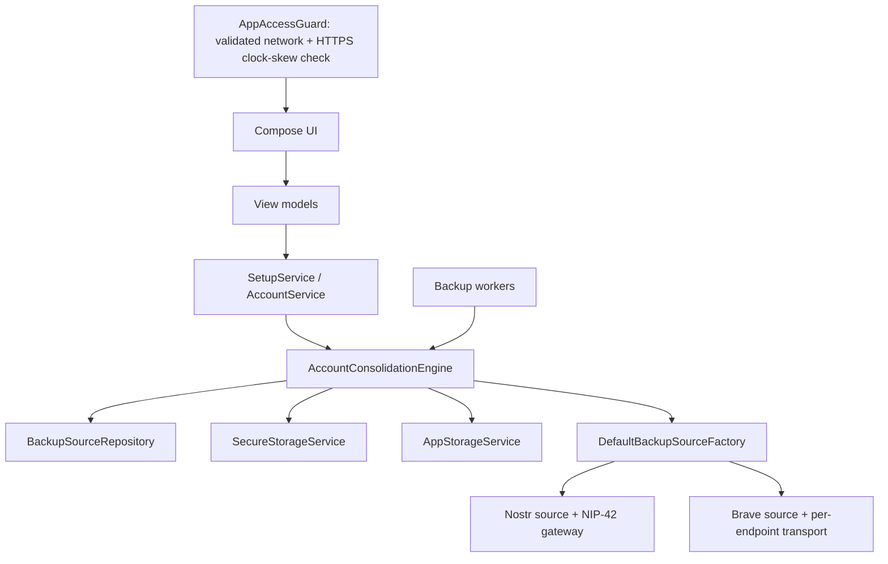

# Architecture overview

## Android application structure

```text
app.zenten.vault
├── ui/           Compose screens, navigation, and view models
├── domain/       Source model, setup, account, backup, and consolidation orchestration
├── crypto/       SSH parsing, seed derivation, Nostr derivation, NIP-44
├── data/         Secure account storage and non-secret operational preferences
├── network/      Nostr relay transport, event encoding, and NIP-42 authentication
├── bravesync/    Brave Sync client, crypto, password records, and transport
├── background/   WorkManager targeted and full-vault consolidation, retry, and periodic work
└── di/           Hilt dependency injection
```

## Primary flow



## Source-oriented model

`BackupSourceConfig` represents one independently checked and written endpoint. Four fixed defaults are merged with persisted custom sources in stable order. The default entries are immutable in repository operations. Each source declares type, endpoint, ordering, enabled/restore/trust/quorum policy, and authentication mode.

`DefaultBackupSourceFactory` constructs one `AccountBackupSource` adapter per configuration. Nostr adapters address exactly one relay through `NostrRelayGateway`; Brave adapters construct `BraveSyncTransport` with exactly one configured server URL. Existing Nostr event and Brave password-record formats are preserved.

The current app has no custom-source management UI. The repository API is retained so a future UI can create and manage custom sources without reimplementing persistence, endpoint validation, ordering, or processing support.

## Serialization boundary

`AccountConsolidationEngine` owns one coroutine `Mutex` around master backup, account backup, pending retry, and consolidation. Within each operation it uses ordered loops and suspend calls without `async`, ensuring no intentional network concurrency across sources or accounts.

## Core lifecycle

1. **Master setup:** persist master locally, inspect/write all sources sequentially, and complete setup only with one eligible Nostr plus one eligible Brave success. Retain the local master on quorum failure.
2. **Associated creation:** generate and save locally, then enqueue background backup; failed sources are persisted as pending IDs.
3. **Consolidation restore:** index every source and restore missing valid associated accounts from trusted sources.
4. **Consolidation backup:** use retained phase-1 indexes to fill gaps, then perform one final read-back per successfully indexed source.
5. **Status:** persist per-account/per-source state and coarse errors. UI observes this state in account and master details.

## App-entry safety gate

`RemoteOperationPrecondition` is the single prerequisite policy for timestamp-sensitive remote operations. It requires an active network with `NET_CAPABILITY_VALIDATED` (excluding captive portals and local-only connections) and a device clock within two minutes of HTTPS server time. It makes non-cached `HEAD` requests to `https://www.google.com/generate_204` and then `https://cloudflare.com`, parses the first usable HTTP `Date` header, and adjusts the result by half of the measured request round-trip time before comparing it to the wall clock. `AppAccessGuard` applies this policy on creation, resume, network changes, and manual retry, replacing navigation with `AppBlockedScreen` for proven internet or clock-skew failures. `AccountConsolidationWorker` applies the same policy before invoking the engine: it retries without producing timestamped remote authentication when internet is not validated or clock skew is known bad. If neither server is available or supplies a valid `Date` header, both paths continue because that failure cannot prove a device-time error. HTTPS/TLS protects the response in transit, but the check does not independently prove either endpoint's clock or the network is trustworthy.

## Background execution

- One `AccountConsolidationWorker` handles both targeted and full-vault work. An optional account ID selects targeted work; otherwise it runs a full-vault cycle.
- One-time targeted work is unique per account.
- Pending-write retry is unique work.
- Immediate consolidation is unique work after setup.
- Periodic consolidation runs every hour with a connected-network constraint.
- `VaultApplication` supplies WorkManager's Hilt worker factory through `Configuration.Provider`; the manifest removes the default WorkManager startup initializer to avoid initializing it without that configuration.
- A persisted checkpoint describes interrupted progress; operations are idempotent by canonical account ID.

## Security boundaries

- Secrets are stored only through `SecureStorageService` or transiently in crypto/network operations.
- `AppStorageService`, WorkManager input, checkpoints, status, and diagnostics contain no keys, passphrases, encrypted backup payloads, sync codes, tokens, or NIP-42 challenges.
- Relay authentication signs kind `22242` on the challenged connection using the master-derived Nostr identity and does not persist the challenge.
- Remote payloads are decrypted only to restore an account missing locally.

## Key references

- `domain/BackupSources.kt`
- `domain/BackupSourceRepository.kt`
- `domain/BackupSourceAdapters.kt`
- `domain/AccountConsolidationEngine.kt`
- `domain/SetupService.kt`
- `background/BackupWorkers.kt`
- `network/nostr/NostrRelayService.kt`
- `data/kv/AppStorageService.kt`
