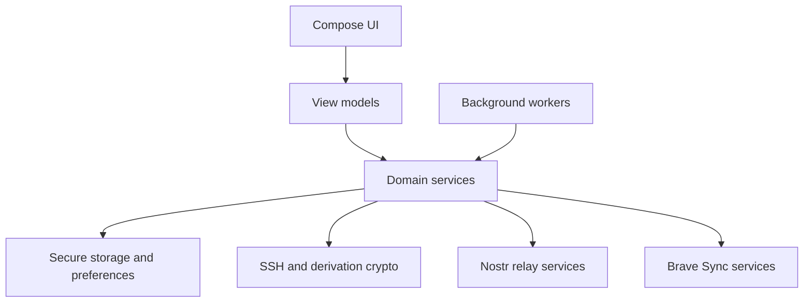

# Architecture overview

## Android application structure

```text
app.zenten.vault
├── ui/           Compose screens, navigation, and view models
├── domain/       Setup, account, backup, recovery, and retry orchestration
├── crypto/       SSH parsing, seed derivation, Nostr derivation, NIP-44
├── data/         Secure storage, preferences, and domain models
├── network/      Nostr relay transport/event encoding
├── bravesync/    Brave Sync client, authentication, crypto, and password records
├── background/   WorkManager reconciliation and retry workers
└── di/           Hilt dependency-injection modules
```

## Primary flow



## Core lifecycle

1. **Setup:** UI provides master-account material to domain setup services. The master account is stored, backed up, and setup is marked complete only after the required backup succeeds. Failure rolls back local setup state.
2. **Associated-account creation:** a domain service allocates an ID, generates a key pair, stores the account locally, then coordinates asynchronous backup and retry scheduling.
3. **Recovery:** after setup and during reconciliation, domain services validate remote candidates and automatically store valid associated accounts that are not already local.
4. **Status and repair:** reconciliation checks each destination, stores coverage status, and only repairs destinations conclusively found missing.

## Design boundaries

- UI code should not parse, derive, encrypt, or transmit secrets directly.
- Domain services coordinate use cases and keep local persistence ahead of asynchronous remote backup.
- Crypto code owns sensitive transformations and must have deterministic tests/vectors for compatibility-sensitive behavior.
- Remote integrations are separated by destination so retry and coverage can be tracked independently.
- Background workers retry/reconcile without becoming an alternative source of product rules.

## Key implementation references

- Setup orchestration: `domain/SetupService.kt`
- Associated-account creation: `domain/AccountService.kt`
- Backup coordination: `domain/AccountBackupCoordinator.kt`
- Recovery: `domain/RecoveryService.kt`
- Reconciliation: `domain/BackupSyncService.kt`
- Secure storage: `data/secure/SecureStorageService.kt`
- Relay transport: `network/nostr/NostrRelayService.kt`
- Sync integration: `bravesync/`

For behavior and limitations per capability, see the [feature documentation](../features/README.md).
