# Brave Sync and litesync backup protocol

## Purpose and scope

This document explains how ZenTen Vault writes account backups to Brave Sync-compatible servers, including the project's `litesync` endpoints. It covers the record format, credential derivation, transport, session lifecycle, write/verify flow, and failure handling at the implementation level.

User-visible backup behavior, source policy, and recovery semantics live in [Encrypted backup](../features/encrypted-backup.md) and [Backup status and consolidation](../features/backup-status-and-reconciliation.md). This document is the engineering walkthrough behind those guarantees.

## Terms used in this document

| Term | Meaning here |
| --- | --- |
| **Sync chain** | One server-side encrypted dataset, identified by a Sync code. All records in a chain share the same encryption keys. |
| **Sync code** | Brave's 25-word BIP-39-style recovery phrase. Vault derives it from the Vault Key seed. |
| **Nigori** | Chromium Sync's encryption layer and the special synced record that stores its key metadata (keybag, KDF method, and, for scrypt, a salt). The server stores it but cannot decrypt it alone. |
| **Keybag** | The container inside Nigori holding the symmetric encryption key, MAC key, and PBKDF2 user key, itself encrypted with the same keys derived from the Sync code. |
| **Key name** | A fingerprint of one derived key set (`NigoriCrypto.computeKeyName`). The app writes a key name into every encrypted payload it creates, but never reads it to choose keys — see [Compatibility scope](#compatibility-scope-and-known-limitations). |
| **KDF** | Key derivation function. Turns a passphrase into key bytes. This implementation supports PBKDF2-SHA1 (fixed salt) and scrypt (salt read from the chain's Nigori). |
| **Salt** | KDF input. Brave's PBKDF2 path uses a fixed 16-byte protocol constant (`NigoriCrypto.pbkdf2Salt`, Chromium's custom-passphrase salt) that is identical in every chain; only scrypt uses a chain-specific salt recorded in Nigori. |
| **PBKDF2 / scrypt** | Deliberately slow KDFs. Slowness makes offline guessing of the Sync code expensive. |
| **AES-CBC** | Symmetric block cipher mode used to encrypt record payloads. |
| **HMAC-SHA256** | Message authentication code appended to ciphertext to detect tampering. |
| **Protobuf** | Chromium Sync's binary wire format. The app encodes/decodes only the fields it needs. |
| **`GET_UPDATES` / `COMMIT`** | The two Sync protocol operations used: list records of one data type, and submit new records. |
| **Sync entity / record** | One protobuf item in the chain. Passwords are entities of data type `45873`; Nigori is `47745`. |
| **Client ID** | Ed25519 public key (hex) derived from the Sync code. Brave uses it to identify the client making a request. |
| **Auth token** | Bearer credential proving possession of the Client ID's private key for a timestamp. |
| **Quorum** | The minimum successful destinations required during Vault Key setup: one Nostr relay and one Brave Sync source. |
| **Consolidation** | The triggered reconciliation pass that indexes sources, restores missing local accounts, writes missing remote records, and verifies them. It runs after an unlocked launch or on user action, not periodically. |
| **Canonical key form** | The single-line Base64 OpenSSH private-key representation stored in every backup. |

## Protocol flow

One endpoint's lifecycle for a single run: establish the session, learn the chain's keys, list what is already stored, then write only what the current index proved absent and confirm it by reading the chain back. The sections below explain each step in detail.

```mermaid
flowchart TD
    Start["Engine derives the Sync code once per run: 24 words plus the date-derived 25th word"] --> Clock{"Network validated and device clock within 2 min of HTTPS server time?"}
    Clock -->|No| Deferred["Fail before any network call; retry later without touching remote state"]
    Clock -->|Yes| Token["Derive Ed25519 keypair from the Sync code and mint a time-stamped Bearer token"]
    Token --> NigoriGet["GET_UPDATES for NIGORI_TYPE_ID (47745)"]
    NigoriGet --> NigoriPresent{"Chain has a Nigori record?"}
    NigoriPresent -->|No| NigoriInit["COMMIT a Nigori entity: PBKDF2 keybag, CUSTOM_PASSPHRASE, encrypt_everything"]
    NigoriPresent -->|Yes| Keys
    NigoriInit --> Keys["Derive AES encryption key and HMAC key from the chain's KDF method and salt"]
    Keys --> ListRecords["GET_UPDATES for PASSWORD_TYPE_ID (45873)"]
    ListRecords --> ListOK{"HTTP 2xx and server error code 0?"}
    ListOK -->|No| Unknown["Mark the source UNKNOWN: never infer absence and never write it this cycle"]
    ListOK -->|Yes| Decrypt["PasswordReader decrypts each entity"]
    Decrypt --> Valid{"MAC, decryption, and URL/username contract valid?"}
    Valid -->|No| Invalid["Counted as invalid; never treated as a backup"]
    Valid -->|Yes| Candidates["Group into RemoteAccountCandidate by BackupAccountId"]
    Candidates --> Absent{"Record absent in this cycle's index?"}
    Absent -->|No| Identical{"Existing record has the identical canonical key?"}
    Identical -->|Yes| Success["Idempotent success"]
    Identical -->|No| Conflict["Fail the source; never overwrite"]
    Absent -->|Yes| Canon["canonicalKey: normalize to single-line Base64 and validate the Ed25519 OpenSSH key"]
    Canon --> Build["PasswordEntityCodec builds the entity and its Nigori-encrypted payload"]
    Build --> Commit["COMMIT with a random commit ID"]
    Commit --> Entry{"response_type == 1 for the entry result?"}
    Entry -->|No| WriteFail["Source write fails; queue the record for retry"]
    Entry -->|Yes| Verify["Re-index the source and look for the record ID"]
    Verify --> Visible{"Record ID visible on read-back?"}
    Visible -->|No| WriteFail
    Visible -->|Yes| Success
    Success --> Quorum{"Vault Key pass only: one eligible Nostr relay and one eligible Brave source succeeded?"}
    Quorum -->|No| Incomplete["Keep the local Vault Key and leave setup incomplete so it can be retried"]
    Quorum -->|Yes| Complete["Setup completes; consolidation records the account as backed up"]
```



Session and key setup are done once per endpoint per run (`withSession`), while the list, write, and verify steps repeat for every record the run handles at that endpoint. The quorum check applies only to the Vault Key pass; account consolidation treats each source independently and reports per-source status.

## What is stored

Backups are stored as **password records**, the same entity type Brave's password manager syncs. One record exists per backup. Associated-account records carry at most one note; the Vault Key record carries none.

| Backup | URL | Username | Password field | Notes |
| --- | --- | --- | --- | --- |
| Vault Key | `https://vaultkey.zenten/` | `vaultkey` | Canonical single-line Base64 OpenSSH private key | Never any note |
| Associated account | `https://<createdAt>.zenten/` | decimal `createdAt` | Canonical single-line Base64 encrypted OpenSSH private key | Optional single `label: <account name>` note; absent when the account has no name |

The password field holds the SSH key text, not JSON or an app-specific blob. The key remains passphrase-protected: the account passphrase is **never** uploaded. The Vault Key's own passphrase is also never stored remotely, which is why the Vault Key only re-enters the app through onboarding.

The note is the only place an associated account's name survives a device change, and it is not encrypted: anyone who can list that account's records can read it. A missing or blank note leaves the restored account's name empty; the UI does not substitute the shortened `npub`. The remote copy is never rewritten just to add or change a name, because presence is decided by URL and username alone.

A record is recognized by URL **and** username matching its canonical backup ID (`vaultkey` or a decimal `createdAt`). The Vault Key record additionally requires an empty notes list; an associated-account record accepts zero or one note, which keeps the name out of record identity.

Two encryption/validation layers must be distinguished:

- **Outer layer — always done during indexing.** `PasswordReader.read` decrypts the Nigori payload of every non-deleted entity (`IV || AES-CBC ciphertext || HMAC-SHA256`), verifies the MAC, and parses URL/username/notes for each record. This is how presence is established, so a chain's record payloads are decrypted on every index pass; presence is not determined from ciphertext alone.
- **Inner layer — deferred to restoration.** Parsing the SSH private key, checking that it decrypts with the account passphrase, and comparing it to the local key happen only when a candidate is restored (`accountFromSshKey`), or for the Vault Key in the narrower `hasVaultKeyBackup` check. A record whose outer payload decrypts and whose URL/username match the backup contract still counts as present even if its SSH key later fails to restore.

Before any write, `canonicalKey` normalizes the value to the single-line Base64 form and parses it as an Ed25519 OpenSSH key. Malformed keys never reach the server.

## Credential derivation

Neither Brave nor litesync uses user accounts. Every credential is derived deterministically from the Vault Key's SSH seed.

```text
Vault Key SSH seed (32 bytes)
  └─ Vault Key backup sub-account seed = SHA256( SHA256("vkbckp") + seed )
       ├─ BIP-39 24 words + date-derived 25th word  → Sync code
       └─ same 24-word mnemonic → Nostr identity for Vault Key relay records

Sync code (first 24 words)
  ├─ BIP-39 data bits → 32-byte entropy
  │    └─ HKDF-SHA512(salt, info="sync-auth-key") → 32-byte Ed25519 private key
  │         ├─ Client ID = public key hex
  │         └─ Bearer token = Base64(timestamp | signature | public key)
  └─ Nigori keys (one key set per chain)
       ├─ PBKDF2-SHA1, fixed Chromium custom-passphrase salt, 1003 / 1004 iterations → AES key + HMAC key
       └─ scrypt (N=8192, r=8, p=11) only when the chain's Nigori says so, using the salt Nigori records
```

Relevant code:

- Sync code and 25th word: `crypto/Seedify.kt`
- Auth token and Client ID: `bravesync/auth/BraveSyncAuth.kt`
- Nigori KDF and record encryption: `bravesync/crypto/NigoriCrypto.kt`

The engine derives the Sync code **once per run** in `DefaultBackupSourceFactory.createRunContext` and reuses it across every Brave endpoint. This avoids repeated SSH decryption and fixes the date-derived 25th word, so a run spanning midnight cannot address two different chains. The code is kept in memory only and is never persisted or logged.

In this implementation, both the auth keypair and the Nigori keys consume **only the first 24 words**. The 25th word is part of the generated Sync code format, but it is not an input to the HKDF or PBKDF2 derivations.

The 25th word's day index wraps modulo the 2,048-word BIP-39 list, matching Brave's own `TimeLimitedWords::GetWordByIndex` (`index = index % BIP39_WORDLIST_LEN`) and its parser. Day index 2048 therefore reuses index 0, day index 4096 does too, and so on. Because Brave and Vault both round elapsed days to the nearest whole day (`std::round` and `Math.round`), the day index advances at noon UTC rather than at midnight, so the first wrap happens at `2027-12-17T12:00:00Z`. The wrap keeps Brave Sync backup and recovery working past the 2,048-day horizon and keeps generated codes interoperable with real Brave clients, instead of failing closed after 17 December 2027.

## Configured endpoints

Default Brave Sync sources from `domain/BackupSources.kt`:

| Label | Endpoint | Counts toward quorum |
| --- | --- | --- |
| `litesync1` | `https://litesync1.zentext.me/litesync` | Yes |
| `litesync2` | `https://litesync2.nostr.box/litesync` | Yes |

Each source is an independent chain with its own transport, in-memory session, Nigori settings, and operation. `BravePasswordService` caches a session per endpoint for the duration of a run (`cacheSession = true`), so authentication and KDF work are not repeated per record within that endpoint.

## Transport

`bravesync/transport/BraveSyncTransport.kt` sends all protocol operations to a single configured server:

```text
POST {endpoint}/command/?client=Chromium&client_id=<URL-encoded Base64(32-byte public key)>
Authorization: Bearer <auth token>
BraveServiceKey: <Brave's public service key>
Content-Type: application/octet-stream
Body: protobuf ClientToServer message (COMMIT or GET_UPDATES)
```

Responses are protobuf and may be gzip-compressed. A non-2xx HTTP status or a non-zero server error code fails the source operation. The `BraveServiceKey` is Brave's public, open-source protocol constant, not a user credential.

## Session lifecycle

`BravePasswordService.withSession` performs the following once per endpoint per run:

1. Derive the Ed25519 keypair from the Sync code and mint a time-stamped Bearer token.
2. Send `GET_UPDATES` for `NIGORI_TYPE_ID` (`47745`).
3. Read the returned Nigori settings and derive **exactly one key set** from the Sync code, the chain's `key_derivation_method`, and its salt. PBKDF2 (method 1) ignores the salt and uses `NigoriCrypto.pbkdf2Salt`, the fixed Chromium custom-passphrase salt. Scrypt (method 2) requires a salt and fails if the Nigori has none. Any other method fails the session. The Nigori's passphrase type and keybag `key_name` are parsed but do not affect key selection.
4. If the chain has no Nigori record (a fresh server or chain), derive the same PBKDF2 keys and commit a Nigori entity via `NigoriInitializer`:
   - KDF method PBKDF2 (field 45), no salt,
   - keybag holding the key name, PBKDF2 user key (1002 iterations), encryption key, and MAC key, encrypted with that same key set,
   - `CUSTOM_PASSPHRASE` passphrase type (field 30),
   - `encrypt_everything` enabled (field 24).

The server never receives the Sync code or the derived keys. It stores only the encrypted keybag and the KDF metadata.

## Index, write, and verify

### Index

`BraveBackupSource.index` calls `BraveSyncBackupService.listRecords`, which sends `GET_UPDATES` for `PASSWORD_TYPE_ID` (`45873`) and decrypts each returned entity with `PasswordReader`.

Entities that fail MAC verification, decryption, or the URL/username contract are counted as invalid and never treated as backups. Valid entities become `RemoteAccountCandidate` values grouped by `BackupAccountId`.

### Write

A write happens only when the same operation's successful index proved the record absent. The flow is:

1. Canonicalize and validate the OpenSSH key.
2. Build a Chromium password entity (`PasswordEntityCodec`):
   - realm/origin derived from the record URL,
   - username and password,
   - manually-added marker and timestamps,
   - client tag hash from `PasswordUniqueTag`,
   - Nigori-encrypted payload (`IV || AES-CBC ciphertext || HMAC-SHA256`).
3. Send `COMMIT` with a random commit ID.
4. Require `response_type == 1` for the entry result; anything else fails the source.

Engine-driven writes use `createKnownMissing`, avoiding a second `GET_UPDATES` because the current cycle already listed the source. Standalone callers keep an idempotency list-and-compare step: an existing identical record is success, and an existing record with a different key is a failure that is never overwritten.

The service also exposes `update` and `delete`, but the backup flow only ever creates records.

### Verify

The engine does not trust the commit acknowledgement alone. After writing, it re-indexes the source and requires the record ID to appear. This applies to **both** record classes: `verifyVaultKeyWrite` confirms each Vault Key write before the source counts toward quorum, and `verifyAccountWrite` (single account) and `verifySourceAfterWrites` (full consolidation) confirm associated-account writes. An acknowledged-but-absent write is recorded as a failure and queued for retry.

## Orchestration and quorum

`AccountConsolidationEngine` serializes all remote work behind one coroutine mutex and processes sources sequentially.

- **Vault Key pass** (`backupVaultKey`): indexes and, where absent, writes the Vault Key record to every enabled source. Setup completes only when quorum is met — at least one quorum-eligible relay and one quorum-eligible Brave source. Each source is attempted even after earlier failures so the full quorum picture is available.
- **Full account consolidation** (`consolidate`): two phases. Phase 1 indexes all sources and restores locally missing accounts from trusted sources. Phase 2 writes every local account missing from each phase-1 index, then performs one read-back per source.
- **Single-account consolidation** (`consolidateAccount`): index, write if absent, verify immediately, without touching other accounts' statuses or records.

Work is scheduled by `background/BackupWorkers.kt`:

- separate post-unlock one-time workers for the Vault Key and associated accounts (no periodic schedule), which take the passphrase from the in-memory session and fail closed when locked,
- one-time targeted runs after account creation,
- manual consolidation that bypasses the freshness threshold,
- retries for pending `(account, source)` writes.

Both workers require a connected network and refuse to produce timestamped tokens or records while the device clock is known to be wrong.

## Failure semantics

| Situation | Behavior |
| --- | --- |
| Chain has no Nigori record | Commit a Nigori entity first, then write the password record |
| Source index fails | Mark the source `UNKNOWN`; never infer absence and never write that source in the cycle |
| Commit rejected / entry result not success | Source write fails and is queued for retry |
| Write acknowledged but not visible on read-back | Treated as failure and queued for retry (both Vault Key and associated-account writes) |
| Existing record with a different payload | Fail the source; never overwrite |
| Record fails outer decryption or URL/username contract | Counted as invalid and skipped |
| Record uses a key name this implementation does not hold | Its outer decryption fails, so it is counted as invalid and skipped |
| Record decrypts but its SSH key fails inner validation | Still counted as present by the index; invalid only at restoration |
| Device clock known incorrect | Worker retries without touching remote state |
| Sync code cannot be derived | Operation fails before any network call |

## Security properties

- The server stores ciphertext and KDF metadata only. Reading a backup requires the Sync code, which is derived from the Vault Key seed.
- The 24-word mnemonic provides the entropy behind the Sync code; the slow KDF raises the cost of offline guessing.
- Account passphrases and Vault Key passphrases are never uploaded.
- The Sync code, derived keys, auth tokens, and decrypted payloads stay in memory. Persisted state contains only IDs, statuses, timestamps, and coarse error categories.
- Each endpoint gets its own transport object and its own in-memory `BravePasswordService` session, and per-source state (statuses, pending retries) is tracked independently. The *derived identity* is nevertheless the same at every Brave-compatible endpoint: one run-scoped Sync code produces the same mnemonic entropy, Ed25519 keypair, Client ID, and Nigori keys everywhere (`DefaultBackupSourceFactory` creates one run context and passes the same code to every `BraveSyncBackupService`). The boundary that holds is that no request is sent to one endpoint using another endpoint's transport or token: each session mints its own token and talks only through its own `BraveSyncTransport`.

## Compatibility scope and known limitations

Key handling is intentionally a **restricted contract**, not general Brave Nigori support: the app interoperates with chains whose encryption matches a single derived key set, and does not implement Nigori key management beyond that.

- **Single key set per chain.** `BravePasswordService.resolveKeys` derives one key set per endpoint per session from the Sync code and the chain's KDF method. `PasswordReader` never inspects `EncryptedData.key_name` to select a key; `BraveSyncConfig` and the service never rotate keys, and no code reads the Nigori keybag to derive alternate keys.
- **Keybag rotation chains are not supported.** If a chain's keybag was rotated (for example by a Brave client changing the passphrase) so the active key differs from the one derived here, records it wrote after rotation cannot be decrypted. This is a deliberate scope decision, not an untested path.
- **Foreign key names surface as invalid records.** A record encrypted under a key name this implementation does not hold simply fails `NigoriCrypto.decrypt` (MAC check), is caught in `PasswordReader.read`, and increments `decryptionFailures`. The index counts it as invalid, so its backup ID does not appear as present and is never restored from it; if no other decryptable record supplies that ID, a later write is attempted under the key set this implementation holds.
- **What a future implementation would need:** read the Nigori keybag and decrypt it with the passphrase-derived user key, maintain a map from key name to key set, select keys per record by `key_name`, follow rotation chains through keybag history, and persist or re-derive keys across sessions.

## Primary implementation locations

- Record contract and Sync code usage: `domain/BraveSyncBackupService.kt`
- Source adapter, run context, and per-endpoint transport/session creation: `domain/BackupSourceAdapters.kt`
- Orchestration, quorum, retries: `domain/AccountConsolidationEngine.kt`
- Session and record API: `bravesync/BravePasswordService.kt`
- Auth derivation: `bravesync/auth/BraveSyncAuth.kt`
- Nigori crypto and initialization: `bravesync/crypto/NigoriCrypto.kt`, `bravesync/NigoriInitializer.kt`
- Record encoding/decoding: `bravesync/password/PasswordEntityCodec.kt`, `PasswordReader.kt`, `PasswordUniqueTag.kt`
- Protocol messages: `bravesync/proto/SyncMessages.kt`, `ProtoWire.kt`
- HTTP transport: `bravesync/transport/BraveSyncTransport.kt`
- Workers: `background/BackupWorkers.kt`
