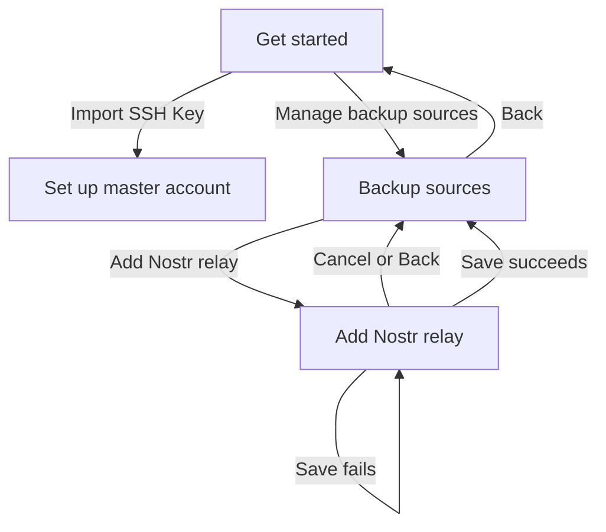

# Pre-setup backup-source management UI plan

## 1. Goal

Add a minimal Material 3 source-management flow that is available only from the **Get started** screen before master-account setup.

The flow lets a user:

- inspect the four immutable built-in backup sources in processing order;
- add up to three custom Nostr relays;
- optionally configure whether a custom relay counts toward Nostr setup quorum;
- optionally trust a custom relay for associated-account recovery; and
- return to onboarding without being required to change or confirm anything.

This release is intentionally additive. It does not provide post-setup access, editing, disabling, removal, reordering, connectivity tests, source health, or custom Brave Sync sources.

## 2. Confirmed product decisions

### 2.1 Entry and availability

- Keep **Import SSH Key** as the primary Get started action.
- Add an outlined secondary action labeled **Manage backup sources**.
- Source management is optional and does not become an onboarding gate.
- Back navigation returns to the previous onboarding screen and preserves the normal navigation stack.
- Do not add an entry point after setup. A future Settings screen may provide one in a separate change.
- The navigation routes are internal Compose routes, with no deep links. Therefore, absence of a post-setup entry point is sufficient for this MVP; this is not treated as a security boundary.

### 2.2 Supported sources

- Display all configured sources in their effective processing order.
- Permit creation of custom `NOSTR_RELAY` sources only.
- Keep the existing built-in Nostr and Brave Sync sources visible.
- Built-in sources remain first, fixed, enabled, and immutable.
- Custom sources are appended after built-ins in creation order.
- Limit source creation through this UI to three custom Nostr relays.
- Do not change the domain repository's broader custom-source APIs in this UI-focused change.

### 2.3 Source policy

A newly added custom relay is always enabled and uses these defaults:

- `countsTowardQuorum = false`
- `restoreEnabled = false`
- `trustedForRestore = false`

An **Advanced settings** expansion exposes:

1. **Count toward setup quorum**
   - Maps to `countsTowardQuorum`.
   - A custom Nostr relay can satisfy only the Nostr side of setup quorum.
   - Setup still requires success from an eligible Brave Sync source.

2. **Use for account recovery**
   - Maps one user-facing switch to both `restoreEnabled` and `trustedForRestore`.
   - Off sets both flags to `false`.
   - On sets both flags to `true`.
   - No warning dialog is required.

The separate domain flags remain intact. Combining them in the form avoids offering a misleading state in which a source is inspected for restore but cannot contribute records to local recovery.

### 2.4 Out of scope

- Post-setup source management
- Custom Brave Sync creation
- Edit source
- Disable source
- Remove source
- Reorder source
- Test connection or source authentication
- Source status/health presentation
- Consolidation scheduling caused by source changes
- Persisted-data migration
- Changes to source adapters or backup formats

## 3. User flow



### 3.1 Get started

Update the existing centered action stack:

1. Filled primary button: **Import SSH Key**
2. Outlined secondary button: **Manage backup sources**

The secondary action navigates to `backup-sources`.

### 3.2 Backup sources list

Use a `Scaffold` with a Material 3 top app bar:

- title: **Backup sources**
- navigation icon: Back
- body: `LazyColumn`
- bottom or list-tail primary action: **Add Nostr relay**

Each source row is non-clickable and displays:

- display label;
- full normalized endpoint;
- human-readable type: **Nostr relay** or **Brave Sync**;
- **Built in** or **Custom** supporting label/badge.

For built-in rows, show concise row-level text such as **Built-in source · Managed by ZenTen Vault**. Do not show controls or a lengthy policy explanation.

For custom rows, show policy summaries where useful:

- **Setup quorum** when `countsTowardQuorum` is true;
- **Account recovery** when both restore/trust flags are true.

Do not show source status such as “Not checked,” because no master account exists yet.

The list observes `BackupSourceRepository.sources`, so it updates immediately after a successful addition and preserves repository processing order.

When three custom Nostr relays already exist:

- disable the **Add Nostr relay** action;
- show concise supporting text: **Maximum of 3 custom relays reached**.

The limit counts non-default sources whose type is `NOSTR_RELAY`. Existing custom sources of another type, if any are already persisted, remain visible but do not consume the custom Nostr limit. There is no migration or destructive cleanup.

### 3.3 Add Nostr relay

Use a separate screen rather than a dialog or bottom sheet. This gives URL validation and advanced controls enough room and keeps list behavior simple.

Fields:

1. **Display name (optional)**
   - Trim leading/trailing whitespace.
   - If blank, derive the label from the normalized endpoint hostname.

2. **Source type**
   - Read-only field/value: **Nostr relay**.

3. **Endpoint URL**
   - Required.
   - Normalize through the existing `normalizeSourceEndpoint`/repository path.
   - Must use `wss://`.
   - Must contain a host.
   - Must not contain credentials, query parameters, or a fragment.
   - Existing repository duplicate detection remains authoritative.

4. Collapsed **Advanced settings** section
   - switch: **Count toward setup quorum**, initially off;
   - switch: **Use for account recovery**, initially off.

Actions:

- **Add relay** submits once and is disabled while saving.
- **Cancel** or top-app-bar Back returns without mutation.
- Successful save immediately pops back to the source list.
- Validation, duplicate, limit, and persistence failures are displayed with a snackbar and leave entered values intact.

The UI should present normalized values on the list after save. It does not need a separate normalization preview in the form.

## 4. State and event design

### 4.1 List state

Create a Hilt ViewModel under `ui/sources/`, backed by `BackupSourceRepository.sources`.

Suggested state:

```kotlin
data class BackupSourcesState(
    val sources: List<BackupSourceConfig> = emptyList(),
    val loading: Boolean = true,
    val customNostrCount: Int = 0,
) {
    val canAddNostr: Boolean get() = customNostrCount < MAX_CUSTOM_NOSTR_SOURCES
}
```

Keep `MAX_CUSTOM_NOSTR_SOURCES = 3` in the source-management UI package. This is a product limit for this entry flow, not a new repository invariant.

The list screen derives display models from domain configs without copying secrets or operational status into UI state.

### 4.2 Add form state

Create a separate Hilt ViewModel to avoid coupling list collection to mutable form state.

Suggested state:

```kotlin
data class AddBackupSourceState(
    val displayName: String = "",
    val endpoint: String = "",
    val countsTowardQuorum: Boolean = false,
    val useForRecovery: Boolean = false,
    val advancedExpanded: Boolean = false,
    val saving: Boolean = false,
    val saved: Boolean = false,
    val message: UiMessage? = null,
)
```

Events/actions:

- `setDisplayName`
- `setEndpoint`
- `setCountsTowardQuorum`
- `setUseForRecovery`
- `setAdvancedExpanded`
- `save`
- `messageShown`

`save()` behavior:

1. Ignore duplicate submissions while `saving`.
2. Read `repository.current()` and reject if three custom Nostr relays already exist. This rechecks the list-screen condition at submission time.
3. Normalize/validate the endpoint as `NOSTR_RELAY` so its hostname can be derived.
4. Use the trimmed display name, or the normalized URI hostname when blank.
5. Call `repository.addCustom` with:
   - type `NOSTR_RELAY`;
   - `enabled = true`;
   - selected `countsTowardQuorum`;
   - `restoreEnabled = useForRecovery`;
   - `trustedForRestore = useForRecovery`.
6. Mark `saved = true` on success.
7. Map expected `IllegalArgumentException` messages to concise user-facing snackbar copy. Use a generic **Could not add relay** message for unexpected persistence failures rather than exposing internal details.

Use a consumable message identifier or clear callback so snackbars do not replay on recomposition.

### 4.3 Label derivation

Add a small pure helper in the UI package:

```kotlin
internal fun customSourceLabel(displayName: String, normalizedEndpoint: String): String
```

It returns the trimmed name when nonblank; otherwise it parses and returns the normalized endpoint hostname. Validation guarantees that a hostname exists before this helper is used.

## 5. Navigation changes

### `VaultDestinations.kt`

Add:

```kotlin
const val BACKUP_SOURCES = "backup-sources"
const val ADD_BACKUP_SOURCE = "backup-sources/add"
```

No arguments or deep links are needed.

### `VaultNavGraph.kt`

Register:

- `BackupSourcesScreen` for `BACKUP_SOURCES`;
- `AddBackupSourceScreen` for `ADD_BACKUP_SOURCE`.

Only `GetStartedScreen` links to `BACKUP_SOURCES`. The list links to `ADD_BACKUP_SOURCE` only while under the configured limit. No accounts, master-account, or root screen link is added.

## 6. Expected file changes

### New production files

- `app/src/main/java/app/zenten/vault/ui/sources/BackupSourcesViewModel.kt`
- `app/src/main/java/app/zenten/vault/ui/sources/BackupSourcesScreen.kt`
- `app/src/main/java/app/zenten/vault/ui/sources/AddBackupSourceViewModel.kt`
- `app/src/main/java/app/zenten/vault/ui/sources/AddBackupSourceScreen.kt`

Small reusable source-row/form helpers may remain in those files unless splitting them materially improves readability.

### Existing production files

- `app/src/main/java/app/zenten/vault/ui/onboarding/GetStartedScreen.kt`
  - add outlined **Manage backup sources** action.
- `app/src/main/java/app/zenten/vault/ui/VaultDestinations.kt`
  - add list/add routes and update stale scope comments.
- `app/src/main/java/app/zenten/vault/ui/VaultNavGraph.kt`
  - register both screens.

No DI module change should be necessary: `BackupSourceRepository` is already provided as a singleton and can be constructor-injected into Hilt ViewModels.

### Domain/data files

No planned production changes to:

- `BackupSourceRepository`
- `BackupSourceConfig`
- `AppStorageService`
- adapters, consolidation engine, or workers

The form explicitly supplies values compatible with the existing repository API.

## 7. Validation and error copy

Use snackbar messages for submission failures, as requested. Recommended copy:

| Condition | Snackbar |
| --- | --- |
| Empty endpoint | `Enter a relay URL` |
| Wrong or missing scheme | `Nostr relay URLs must use wss://` |
| Missing host or malformed URL | `Enter a valid Nostr relay URL` |
| Credentials/query/fragment | `Relay URLs cannot include credentials, a query, or a fragment` |
| Duplicate normalized endpoint | `That backup source already exists` |
| Three-relay limit | `You can add up to 3 custom relays` |
| Unexpected failure | `Could not add relay` |

Do not display raw exception classes, storage details, authentication material, or server details beyond the endpoint the user entered.

## 8. Accessibility and Material 3 baseline

Follow existing Compose patterns while meeting basic accessible interaction requirements:

- every navigation icon has a meaningful content description;
- switches have visible labels and whole-row toggle targets where practical;
- built-in/custom and policy meaning is textual, not color-only;
- endpoint text can wrap or ellipsize without hiding the source label/type;
- disabled add state includes explanatory text rather than relying on disabled styling;
- form fields have persistent labels;
- snackbar errors are emitted through `SnackbarHostState`;
- scrolling supports small screens and large font scales;
- saving progress has a textual or semantic indication and prevents duplicate submission.

No new visual design system or dependency is required.

## 9. Test plan

Follow the repository's current host-side JUnit/coroutine-test patterns. Add focused tests rather than introducing a new broad UI-test framework.

### 9.1 ViewModel/helper unit tests

Add tests under `app/src/test/java/app/zenten/vault/ui/sources/` covering:

- sources retain repository processing order;
- custom Nostr count excludes defaults and non-Nostr custom entries;
- add is allowed for counts 0–2 and disallowed at 3;
- blank display name derives the normalized hostname;
- nonblank display name is trimmed and retained;
- saved source type is always `NOSTR_RELAY`;
- endpoint is normalized by the existing source rules;
- default advanced flags are false;
- quorum selection maps to `countsTowardQuorum`;
- recovery selection maps to both `restoreEnabled` and `trustedForRestore`;
- successful save emits completion for back navigation;
- duplicate endpoint emits a consumable user message and preserves fields;
- malformed/non-`wss` endpoint emits a user message;
- submit-time custom-relay limit prevents a fourth source;
- repeated save while in progress does not issue duplicate writes, where practical with the chosen test seam.

Because `BackupSourceRepository` is concrete, use the existing temporary DataStore fixture pattern unless a small package-local state reducer/helper gives sufficient isolated coverage. Do not refactor the domain into new interfaces solely for UI mocking.

### 9.2 Navigation tests

Extend `VaultDestinationsTest.kt` to assert the exact new route constants.

### 9.3 Repository regression

Existing `BackupSourceRepositoryTest` already covers normalization, duplicate rejection, ordering, and persisted custom source behavior. Add a case only if implementation reveals an uncovered repository contract; do not change its support for custom Brave sources because the restriction is UI-only.

### 9.4 Build verification

Run:

```bash
./gradlew testDebugUnitTest
./gradlew assembleDebug
```

If the environment has an emulator/device and time permits, manually verify navigation, snackbar behavior, large text, and process recreation of persisted additions. New instrumentation tests are not required for this MVP unless implementation logic cannot be covered reliably with host tests.

## 10. Documentation updates required with implementation

Behavior and user-visible navigation change, so implementation must update documentation in the same change.

### New feature document

Add `docs/features/backup-source-management.md` describing:

- pre-setup-only access;
- four locked defaults;
- custom Nostr-only creation;
- three-relay limit;
- label fallback and URL rules;
- advanced quorum/recovery controls and their defaults;
- immutable/additive MVP limitations;
- primary implementation locations.

Link it from `docs/features/README.md`.

### Existing stakeholder/technical documents

Update:

- `docs/stakeholder/screens-and-states.md`
  - add both source screens and navigation branches;
  - document list/form states and pre-setup-only availability.
- `docs/stakeholder/user-journeys.md`
  - add the optional source-configuration path before key import.
- `docs/stakeholder/backup-and-recovery.md`
  - replace “no source-management screen exists” with the exact MVP limitations.
- `docs/stakeholder/scope-and-roadmap.md`
  - record pre-setup custom Nostr source creation as implemented/PoC when complete.
- `docs/technical/product-status.md`
  - update source repository/UI status and repository evidence.
- `docs/technical/architecture.md`
  - note that the UI exposes only additive pre-setup Nostr configuration and maps its combined recovery control to both restore/trust flags.

Keep statements clear that domain support for custom Brave sources is not currently exposed in this UI.

## 11. Acceptance criteria

1. A fresh, incomplete setup shows **Import SSH Key** as the primary action and **Manage backup sources** as an outlined secondary action.
2. Selecting **Manage backup sources** opens **Backup sources** without requiring source review before master import.
3. The screen lists the four built-ins first in fixed processing order with label, type, full endpoint, and built-in/managed text.
4. Built-in rows have no edit, disable, remove, or reorder actions.
5. A user can open a separate **Add Nostr relay** screen.
6. Source type is visible and read-only as **Nostr relay**.
7. A valid `wss://` endpoint can be saved with an optional display name.
8. A blank display name becomes the normalized endpoint hostname.
9. Invalid, insecure, credential-bearing, query-bearing, fragment-bearing, and duplicate endpoints are rejected through snackbar feedback.
10. Advanced settings are collapsed initially.
11. **Count toward setup quorum** defaults off and maps only to `countsTowardQuorum`.
12. **Use for account recovery** defaults off and maps identically to `restoreEnabled` and `trustedForRestore`.
13. All new custom sources are enabled and appended after built-ins.
14. Successful save returns immediately to the refreshed source list.
15. Custom rows are informational and non-clickable.
16. The UI prevents adding a fourth custom Nostr relay and communicates the three-source maximum.
17. Back/cancel causes no source mutation and returns to the previous onboarding screen.
18. No post-setup screen receives a source-management entry point.
19. No connection test, edit, disable, removal, reorder, status, or custom Brave control is present.
20. Unit tests and debug assembly pass, and all listed documentation accurately reflects the implemented behavior.

## 12. Implementation sequence

1. Add route constants and navigation registrations.
2. Add list ViewModel/state and list screen.
3. Add form ViewModel/state, validation mapping, and form screen.
4. Add the Get started secondary action.
5. Add helper/ViewModel/navigation tests.
6. Run unit tests and debug build; fix accessibility/build issues.
7. Add and update the required feature, stakeholder, and technical documentation.
8. Perform a final scope check to ensure no post-setup management or destructive controls were introduced.
